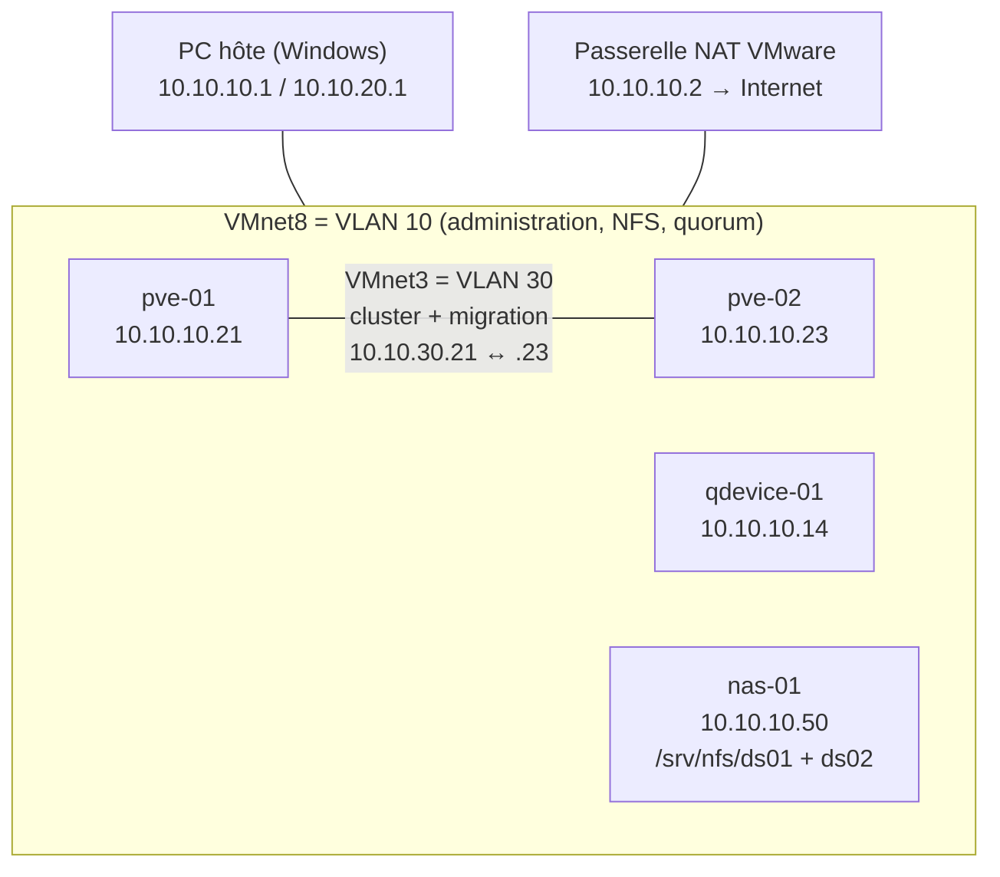

# PPE — Déploiement d'une solution Proxmox VE (semaine 2)

**Étudiant :** Paul Giocanti, classe E1B
**Formateur :** Morrad
**Période :** du 9 au 13 novembre 2026
**État du rapport :** tâche 1 et prérequis terminés. Ce document est complété chaque jour jusqu'au rendu du vendredi 13 novembre.

[TOC]

---

## 1. La mission

Le client (Satom IT & Learning Solutions) veut une plateforme de virtualisation **open source, résiliente et évolutive** sous **Proxmox VE**. Concrètement :

- deux serveurs Proxmox (des **nœuds**) réunis en **cluster** : un groupe de serveurs qui se surveillent et se partagent le travail ;
- un **QDevice** : une petite machine « arbitre » qui donne une troisième voix au cluster. Avec seulement deux nœuds, si le lien entre eux est coupé, aucun des deux ne sait si c'est l'autre qui est en panne. L'arbitre permet de garder une majorité, appelée le **quorum** ;
- un **stockage partagé NFS** sur un NAS. Les deux nœuds lisent les mêmes disques de VM, ce qui permet de déplacer une VM d'un nœud à l'autre sans recopier son disque ;
- puis les tests : haute disponibilité (HA), migration à chaud, déplacement de disque à chaud, placement du stockage, snapshots, clones, modèles et permissions.

C'est l'équivalent open source du TP VMware vCenter de la semaine précédente :

| vCenter (semaine 1) | Proxmox VE (semaine 2) |
|---|---|
| Hôtes ESXi en cluster | Nœuds Proxmox en cluster (Corosync) + QDevice |
| Datastore NFS | Stockage NFS |
| HA | HA |
| vMotion | Migration à chaud |
| Storage vMotion | Move disk (déplacement de disque à chaud) |
| SDRS | N'existe pas : placement manuel (tâche 8) |

---

## 2. Conditions de réalisation et choix techniques

### 2.1 Le matériel

Cette semaine, le TP est réalisé **sans serveur de l'école**, uniquement sur mon PC portable : Lenovo Legion Pro 5 (Intel Core i9-14900HX, 32 Go de RAM, SSD de 1 To), avec **VMware Workstation Pro**. Les quatre serveurs du TP (pve-01, pve-02, nas-01, qdevice-01) sont donc des machines virtuelles.

### 2.2 Virtualisation imbriquée et émulation

Un nœud Proxmox est un hyperviseur. Ici, il tourne lui-même dans une VM : on parle de **virtualisation imbriquée**. Pour être rapide, elle a besoin des fonctions de virtualisation du processeur (**Intel VT-x**). Or, sur mon PC, la **sécurité basée sur la virtualisation de Windows (VBS)** est active : Windows lance son propre hyperviseur et garde ces fonctions pour lui (article Broadcom 389469).

**Choix retenu :** je ne désactive pas la sécurité de Windows, comme dans mes TP précédents sur KVM et OpenStack. Proxmox s'installe et fonctionne normalement. Seules les VM créées *dans* Proxmox tourneront en **émulation** : le processeur est imité par un logiciel (QEMU/TCG). Cela fonctionne, mais plus lentement. C'est pourquoi la VM Debian de la tâche 5 sera une petite image légère.

### 2.3 Écarts avec le cahier des charges

| Cahier des charges | Réalisé | Pourquoi |
|---|---|---|
| VLAN 10, 20 et 30 | Réseaux VMware séparés : **VMnet8** (VLAN 10), **VMnet2** (VLAN 20), **VMnet3** (VLAN 30) | Chaque VMnet est un switch virtuel indépendant, comme un VLAN. Sous Windows, VMware ne propose que VMnet0 à VMnet19 |
| Passerelle `10.10.10.1` | `10.10.10.2` | Sur un réseau NAT VMware, `.1` est pris par le PC hôte et `.2` est la passerelle vers Internet |
| Bridge `vmbr1` « sur VLAN 30 » | `vmbr1` sur une carte réseau dédiée (`nic1`) | Chaque VLAN a sa propre carte virtuelle : pas besoin d'étiquettes VLAN |
| Nœuds à 16 Go de RAM | 8 Go par nœud | 2 × 16 Go + NAS + QDevice dépasseraient les 32 Go du PC |
| NAS : 2 × 100 Go | 2 × 20 Go en allocation dynamique | Pour que la tâche 8 (remplir un stockage à plus de 80 %) reste réalisable sur le SSD du portable |
| VM Windows Server 2022 (tâche 5) | Abandonnée | En émulation, Windows Server mettrait des heures à s'installer |

### 2.4 Architecture et plan d'adressage

| Machine | Nom complet | Adresse | Carte | Réseau VMware |
|---|---|---|---|---|
| pve-01 (administration, `vmbr0`) | pve-01.satom.lab | 10.10.10.21/24 | nic0 | VMnet8 |
| pve-01 (cluster, `vmbr1`) | — | 10.10.30.21/24 | nic1 | VMnet3 |
| pve-02 (administration, `vmbr0`) | pve-02.satom.lab | 10.10.10.23/24 | nic0 | VMnet8 |
| pve-02 (cluster, `vmbr1`) | — | 10.10.30.23/24 | nic1 | VMnet3 |
| qdevice-01 | qdevice-01.satom.lab | 10.10.10.14/24 | ens33 | VMnet8 |
| nas-01 | nas-01.satom.lab | 10.10.10.50/24 | ens33 | VMnet8 |

| Machine | Processeurs | RAM | Disques |
|---|---|---|---|
| pve-01 et pve-02 | 4 | 8 Go | 64 Go |
| nas-01 | 1 | 1 Go | 16 Go (système) + 2 × 20 Go (ds01, ds02) |
| qdevice-01 | 1 | 1 Go | 8 Go |

### 2.5 Méthode de travail

- Chaque commande est tapée à la main après avoir compris son rôle, puis **vérifiée** par une commande de contrôle (`ip a`, `ping`, `df -h`, `exportfs -v`…).
- Avant de modifier un fichier de configuration, j'en fais une **copie de sauvegarde** (`cp fichier fichier.bak`), et je **relis** le fichier avant de l'appliquer.
- Ce TP a été préparé et guidé avec l'aide de Claude (une IA), utilisé comme support d'apprentissage.

---

## 3. Les réseaux virtuels

Avant d'installer quoi que ce soit, j'ai créé les trois réseaux dans l'**Éditeur de réseau virtuel** de VMware (menu Modifier). Tous les serveurs se branchent dessus.

Le réseau **VMnet8** existait déjà, en mode NAT. Je lui ai donné le sous-réseau `10.10.10.0/24` du plan d'adressage. C'est le VLAN 10 : administration des nœuds, NFS et quorum.

VMnet8 est en mode **NAT** sur `10.10.10.0` avec le DHCP actif. Le DHCP ne distribue que les adresses `.128` à `.254`, donc il ne gêne pas les adresses fixes du plan (`.14`, `.21`, `.23`, `.50`).

Pour le **VLAN 30**, le réseau du cluster, j'ai créé **VMnet3** en « Hôte uniquement », **sans** adaptateur hôte et **sans** DHCP.

La colonne « Connexion d'hôte » affiche `-` : le PC n'a pas d'adresse sur ce réseau. Seuls les deux nœuds s'y parlent. C'est voulu : **Corosync**, le système qui permet aux nœuds de se surveiller en permanence, est très sensible aux retards. On l'isole donc du reste du trafic.

Pour le **VLAN 20**, le réseau des VM, j'ai créé **VMnet2** en « Hôte uniquement », **avec** l'adaptateur hôte et sans DHCP.

Ici, le PC prend l'adresse `10.10.20.1`. Elle servira de cible au ping continu pendant la migration à chaud (tâche 6).

---

## 4. Tâche 1 — Installation des nœuds

### 4.1 Préparation des VM

Les VM PVE-01 et PVE-02 existaient déjà (8 Go de RAM, 4 processeurs, 64 Go de disque). Je les ai reprises en ajoutant une carte réseau par VLAN. Pour PVE-01 :

PVE-01 a trois cartes : **NAT** (VLAN 10), **VMnet3** (VLAN 30) et **VMnet2** (VLAN 20). Sur un vrai serveur, ce seraient trois ports réseau physiques.

PVE-02 a reçu exactement la même configuration. Dans un cluster, les nœuds doivent être identiques, pour qu'un nœud puisse accueillir les VM de l'autre sans surprise.

Les cartes 2 et 3 de PVE-02 sont bien sur VMnet3 et VMnet2, comme sur PVE-01.

### 4.2 Installation de Proxmox VE 9.2

L'ISO `proxmox-ve_9.2-1.iso` est montée dans le lecteur CD de la VM. Comme l'ancien disque contenait déjà un Proxmox, j'ai dû passer par le BIOS de la VM (« Mettre sous tension dans le microprogramme ») pour démarrer sur le CD en premier (voir *Problèmes rencontrés*).

C'est le menu de l'installateur Proxmox VE 9.2. J'ai choisi l'installation graphique.

Au lancement, l'installateur affiche un avertissement :

« No support for hardware-accelerated KVM virtualization detected » : Proxmox ne trouve pas les fonctions VT-x du processeur. C'est la conséquence attendue du choix expliqué en 2.2. L'installation continue normalement, et les VM de Proxmox tourneront en émulation.

Sur l'écran réseau, j'ai saisi les valeurs du plan d'adressage :

L'interface de management est **nic0** (la carte NAT). Le nom est `pve-01.satom.lab` (FQDN : nom de la machine + domaine), l'adresse `10.10.10.21/24`, la passerelle et le DNS `10.10.10.2`. Proxmox 9 nomme les cartes `nic0`, `nic1`, `nic2` et « épingle » ces noms. Ainsi, une mise à jour du système ne peut pas renommer une carte et couper le serveur du réseau.

Avant de lancer l'installation, le récapitulatif permet de tout vérifier :

Système de fichiers ext4 sur `/dev/sda`, fuseau Europe/Zurich, clavier fr-ch, nic0, `10.10.10.21/24` : tout correspond. J'ai décoché le redémarrage automatique pour pouvoir débrancher l'ISO avant de redémarrer.

L'installation est terminée. L'écran indique déjà l'adresse de l'interface web : `https://10.10.10.21:8006`.

pve-02 a été installé de la même façon. Seuls le nom et l'adresse changent :

`pve-02`, `10.10.10.23/24` : conforme au plan d'adressage.

### 4.3 Premier démarrage et interface web

Après avoir débranché l'ISO, chaque nœud démarre sur son disque et affiche sa console :

pve-01 démarre et affiche `https://10.10.10.21:8006/` et `pve-01 login:`. Le nœud est opérationnel.

pve-02 démarre lui aussi sur son disque, avec `https://10.10.10.23:8006/`.

**Comprendre l'adresse `https://10.10.10.21:8006` :** `https` est le protocole web chiffré, `10.10.10.21` l'adresse IP du nœud, et `8006` le **port**, la « porte » sur laquelle l'interface de Proxmox écoute. Le port est le même sur toutes les installations Proxmox. Si on a oublié l'IP d'un nœud, la console l'affiche au démarrage, ou on la retrouve avec `ip a` (ligne `inet` sous `vmbr0`).

Je me suis connecté à l'interface web depuis le navigateur du PC hôte, avec le compte `root` et le domaine « Linux PAM » :

À gauche, l'arbre Datacenter → pve-01. À droite, les stockages par défaut : `local` (ISO et modèles) et `local-lvm` (disques de VM). En bas, le journal des tâches. Une première erreur y est déjà visible, traitée au point suivant.

### 4.4 Tâche 1.2 — Dépôts « no-subscription » et mises à jour

Le journal indique une erreur sur la mise à jour automatique de la liste des paquets :

Le message « exit code 100 » dit seulement que la commande a échoué, sans donner la cause. Pour la trouver, j'ai relancé la même commande à la main dans le Shell du nœud :

Les dépôts Debian répondent (`Hit`), donc **Internet fonctionne**. En revanche, les dépôts `enterprise.proxmox.com` renvoient **`401 Unauthorized`** : ils sont réservés aux clients qui ont un abonnement payant. Un **dépôt** est un serveur qui stocke les logiciels et leurs mises à jour, et `apt` est l'outil de Debian qui va les chercher.

**Solution (tâche 1.2) :** dans *pve-01 → Updates → Repositories*, j'ai désactivé les deux dépôts enterprise (pve et ceph-squid) et ajouté le dépôt gratuit **No-Subscription**.

« You get updates for Proxmox VE » : le nœud reçoit à nouveau ses mises à jour. Le bandeau orange rappelle que ce dépôt n'est pas recommandé en production. C'est un choix normal pour un labo, alors qu'une entreprise en production prendrait un abonnement. Ces réglages sont stockés dans de simples fichiers texte, dans `/etc/apt/sources.list.d/`.

La même correction a été faite sur pve-02 :

Sur pve-02 aussi, `pve-no-subscription` est activé et le dépôt enterprise est désactivé (tiret « — »).

Ensuite, sur chaque nœud : `apt update` (télécharger la **liste** des paquets disponibles), puis `apt full-upgrade` (installer les nouvelles versions, en autorisant l'ajout ou le retrait de paquets si nécessaire, comme le recommande Proxmox). Vérification avec `pveversion` et `apt list --upgradable` :

pve-01 affiche `pve-manager/9.2.26`. Un nouveau noyau (`7.0.14-28`) a été installé, mais le nœud tourne encore sur l'ancien (`running kernel: 7.0.2-6`) : un nouveau noyau n'est utilisé qu'après un redémarrage.

Sur pve-02, `apt list --upgradable` ne renvoie plus rien : aucune mise à jour en attente. Lui aussi est en **9.2.26**. Les deux nœuds ont la **même version**, condition indispensable avant de les réunir en cluster. Ils ont ensuite été redémarrés pour charger le nouveau noyau.

### 4.5 Tâche 1.3 — Le réseau du cluster (`vmbr1`)

Un **bridge** (pont) est un switch virtuel à l'intérieur de Proxmox. `vmbr0`, créé à l'installation, porte l'administration. J'ai créé `vmbr1` sur la carte `nic1` (VMnet3) pour le cluster et les migrations : *pve-01 → System → Network → Create → Linux Bridge*.

`10.10.30.21/24`, **sans passerelle** : ce réseau ne sort jamais vers Internet, et un serveur ne doit avoir qu'une seule passerelle (celle de vmbr0). Port `nic1`. « Autostart » est coché pour que le bridge revienne après un redémarrage. « VLAN aware » est décoché, puisque chaque VLAN a sa propre carte.

Après « Apply Configuration », `vmbr1` est actif (Active : Yes) sur `nic1`, qui est passée elle aussi à Active : Yes. La configuration est écrite dans le fichier `/etc/network/interfaces` du nœud.

Même configuration sur pve-02, avec l'adresse `10.10.30.23/24`.

### 4.6 Tâche 1.4 — Test de connectivité sur le réseau du cluster

Mon premier test était faux, et il est instructif :

Depuis pve-02, j'ai pingé `10.10.30.23`, c'est-à-dire **sa propre adresse**. La machine s'est répondu à elle-même. L'indice : un temps de **0,016 ms**, bien trop court pour un vrai trajet réseau. Ce test ne prouve rien sur le lien entre les deux nœuds.

Le bon test, demandé par l'énoncé : `ping -c 4 10.10.30.23` **depuis pve-01**. L'option `-c 4` envoie 4 paquets puis s'arrête.

4 paquets envoyés, 4 reçus, **0 % de perte**, avec des temps entre 0,3 et 0,8 ms : c'est un vrai aller-retour par VMnet3. Le réseau du cluster fonctionne. **La tâche 1 est terminée.**

---

## 5. Prérequis — Stockage partagé (nas-01) et arbitre (qdevice-01)

L'énoncé suppose que le NAS et le QDevice existent déjà. Sans serveur de l'école, je les ai créés moi-même : deux VM **Debian 12**, installées depuis l'ISO `debian-12.15.0-amd64-netinst.iso`. *Netinst* veut dire que l'ISO est petite et télécharge le reste depuis Internet pendant l'installation.

### 5.1 nas-01 — Installation

nas-01 a 1 Go de RAM, 1 processeur, un disque système de 16 Go et **deux disques de données de 20 Go** (ds01 et ds02). Les données sont séparées du système : on peut réinstaller le système sans toucher aux données. On voit « Taille actuelle : 2.6 Mo » pour une taille maximale de 20 Go : c'est l'**allocation dynamique** (thin provisioning). Le fichier du disque ne grossit qu'au fur et à mesure qu'il se remplit.

Au partitionnement, il fallait installer Debian sur le **disque système** (`sda`), et pas sur un disque de données :

Seul `sda` est modifié : une partition en ext4 (le format de fichiers standard de Linux) et une partition de **swap** (zone de secours quand la RAM est pleine).

Le tableau confirme : `sda` contient ext4 monté sur `/` (la racine, l'équivalent de `C:\`) et la swap, tandis que `sdb` et `sdc` (21,5 GB) restent intacts. Debian compte en GB (10⁹ octets) et VMware en Gio (2³⁰ octets) : 20 Gio = 21,5 GB.

Seuls le **serveur SSH** (administration à distance) et les **utilitaires usuels** sont installés. Il n'y a pas d'interface graphique. C'est le principe de **surface d'attaque minimale** : moins de logiciels, c'est moins de failles possibles et moins de mémoire utilisée.

### 5.2 nas-01 — Adresse IP fixe

Après l'installation, nas-01 avait reçu une adresse du DHCP :

`inet 10.10.10.131/24 … dynamic`, avec `valid_lft 1403sec` : l'adresse est **prêtée** pour une durée limitée et peut changer. Un NAS doit garder une adresse fixe, puisque les nœuds iront chercher leurs disques à une adresse précise.

J'ai donc sauvegardé puis modifié `/etc/network/interfaces` avec l'éditeur `nano` :

| Ligne | Rôle |
|---|---|
| `allow-hotplug ens33` | Activer la carte dès qu'elle est détectée |
| `iface ens33 inet static` | Adresse IPv4 **fixe** (au lieu de `dhcp`) |
| `address 10.10.10.50/24` | L'adresse du plan d'adressage |
| `gateway 10.10.10.2` | La passerelle vers Internet |

Après un redémarrage :

`inet 10.10.10.50/24` sans « dynamic », avec `valid_lft forever` : l'adresse est fixe. Le ping vers pve-01 répond (0 % de perte), donc nas-01 est sur le même réseau que les nœuds. On voit aussi deux erreurs de syntaxe sur `ping` avant la bonne commande (voir *Problèmes rencontrés*).

### 5.3 nas-01 — Disques de données et partages NFS

Avant de formater, j'ai vérifié les disques avec `lsblk` (*list block devices*) :

`sda` porte le système. `sdb` et `sdc` (20G) n'ont aucune partition et ne sont montés nulle part : ce sont bien les disques à formater. Cette vérification évite d'effacer le mauvais disque.

J'ai ensuite installé le serveur NFS (`apt install nfs-kernel-server`) et formaté les deux disques en leur donnant une **étiquette** :

« Creating config file /etc/exports » confirme l'installation du serveur NFS. `mkfs.ext4 -L ds01 /dev/sdb` et `mkfs.ext4 -L ds02 /dev/sdc` se terminent par « done ». Les messages « is a disabled or a static unit » ne sont pas des erreurs : ce sont des services NFS optionnels qui restent arrêtés.

Pour que les disques soient **montés** (accrochés à un dossier) à chaque démarrage, j'ai créé `/srv/nfs/ds01` et `/srv/nfs/ds02` (`mkdir -p`), puis ajouté deux lignes dans `/etc/fstab`, la table des disques montés automatiquement :

| Colonne | Exemple | Sens |
|---|---|---|
| Disque | `LABEL=ds01` | Désigné par son étiquette, qui ne change pas, contrairement à `/dev/sdb` |
| Point de montage | `/srv/nfs/ds01` | Le dossier auquel le disque est accroché |
| Type | `ext4` | Le format |
| Options | `defaults` | Lecture/écriture normales |
| dump / pass | `0 2` | Pas de sauvegarde `dump`. Vérification au démarrage après le disque système |

Puis `systemctl daemon-reload` (comme l'indique le commentaire en tête du fichier), `mount -a` pour tout monter, et `df -h` pour contrôler :

`/dev/sdb` est monté sur `/srv/nfs/ds01` et `/dev/sdc` sur `/srv/nfs/ds02`, 20G chacun. `mount -a` n'a affiché aucun message : sous Linux, l'absence de message signifie que tout s'est bien passé.

Enfin, le partage réseau. Le fichier `/etc/exports` déclare ce que le NAS partage, et avec qui :

| Élément | Sens |
|---|---|
| `10.10.10.0/24` | Seul le réseau d'administration (les nœuds) a accès |
| `rw` | Lecture et écriture |
| `sync` | Le NAS ne confirme une écriture qu'une fois les données réellement sur le disque : plus sûr en cas de coupure |
| `no_subtree_check` | Désactive une vérification inutile (valeur recommandée) |
| `no_root_squash` | Proxmox travaille en root et doit pouvoir écrire. Ce compromis de sécurité est compensé par la restriction à `10.10.10.0/24` |

**Point d'attention :** aucun espace entre `/24` et la parenthèse. Avec un espace, les options s'appliqueraient à **tout le monde**, et le partage serait ouvert à n'importe qui.

Application avec `exportfs -ra`, puis vérification avec `exportfs -v` :

Les deux partages sont actifs et réservés à `10.10.10.0/24`. NFS affiche aussi ses options par défaut (`wdelay`, `hide`, `secure`…). **nas-01 est prêt** pour la tâche 3.

### 5.4 qdevice-01

Le QDevice est volontairement minimal, conformément au cahier des charges (1 vCPU, 1 Go de RAM) :

1 Go de RAM, 1 processeur, l'ISO Debian, le réseau NAT, et pas de carte son. On retire d'un serveur tout le matériel inutile.

Après l'installation, la machine portait un mauvais nom (« Lami »). Je l'ai corrigé sans réinstaller, avec `hostnamectl set-hostname qdevice-01` et en modifiant `/etc/hosts`, un annuaire local qui associe des noms à des adresses :

La ligne `127.0.1.1  qdevice-01.satom.lab  qdevice-01` donne à la machine son nom complet et son nom court. `127.0.1.1` est une adresse spéciale qui désigne la machine elle-même.

Après redémarrage, la console affiche `qdevice-01 login:` et `root@qdevice-01` : le nouveau nom est pris en compte.

L'adresse fixe a été configurée comme sur nas-01 :

La configuration statique utilise `address 10.10.10.14/24` et `gateway 10.10.10.2`.

`inet 10.10.10.14/24`, `valid_lft forever`, et un ping vers pve-01 sans perte : **qdevice-01 est prêt** à devenir l'arbitre du cluster (tâche 2).

---

## 6. Problèmes rencontrés

| # | Problème | Cause | Solution |
|---|---|---|---|
| 1 | « No support for KVM virtualization » à l'installation de Proxmox | La sécurité VBS de Windows garde les fonctions VT-x du processeur | Choix de l'émulation pour les VM de Proxmox, sans baisser la sécurité du PC (voir 2.2) |
| 2 | Les VM PVE démarraient sur l'ancien Proxmox au lieu de l'installateur | Le disque passait avant le CD dans l'ordre de démarrage | « Mettre sous tension dans le microprogramme », puis CD-ROM en premier dans l'onglet Boot du BIOS |
| 3 | pve-02 a redémarré sur l'installateur après l'installation | L'ISO était encore branchée | Décocher « Connecté » sur le CD/DVD, puis réinitialiser la VM |
| 4 | `apt-get update` en erreur (« exit code 100 ») | Dépôts *enterprise* réservés aux abonnés : `401 Unauthorized` | Dépôts enterprise désactivés, dépôt *no-subscription* ajouté |
| 5 | `apt full-upgrade` lancé sur pve-02 avant l'ajout du dépôt | `apt` n'utilise que les dépôts configurés au moment où il tourne | Relance de `apt update` + `apt full-upgrade` une fois le dépôt ajouté |
| 6 | Erreurs de saisie : `apt list--upgradable`, `apt liste`, `update` seul | Espace manquant, faute de frappe, sous-commande sans `apt` | Une commande = programme + action + options, séparés par des espaces |
| 7 | Premier ping de la tâche 1.4 sans valeur | Ping lancé depuis pve-02 vers sa propre adresse (0,016 ms) | Ping refait depuis pve-01 vers pve-02 (0,3 à 0,8 ms) |
| 8 | `ping -c 10.10.10.21` puis `10.10.10..21` | `-c` attend un nombre. Une adresse avec deux points collés est prise pour un nom DNS | Commande corrigée : `ping -c 4 10.10.10.21` |
| 9 | `adress` au lieu de `address` dans `/etc/network/interfaces` (nas-01 et qdevice-01) | Faute d'orthographe (en anglais : *address*) | Repéré à la relecture, avant d'appliquer la configuration |
| 10 | qdevice-01 installé avec le nom « Lami » | Mauvaise saisie dans l'installateur | `hostnamectl set-hostname` + correction de `/etc/hosts`, sans réinstaller |
| 11 | Ligne coupée dans nano | Ctrl+K = « Couper », pas « Enregistrer » (Ctrl+O) | Ligne restaurée avec Ctrl+U (« Coller ») |
| 12 | `/etc/fstab` : `serv/nfs/ds01` et `lABEL=ds02` | Chemin sans `/` et mal orthographié. Linux distingue majuscules et minuscules | Corrigé avant `mount -a` (une erreur dans fstab peut empêcher le démarrage) |
| 13 | `/etc/exports` : espace avant la parenthèse pour ds02 | Avec un espace, les options valent pour tout le monde | Corrigé avant `exportfs -ra` |

---

## 7. Avancement

- [x] Réseaux virtuels (VLAN 10, 20, 30)
- [x] **Tâche 1** : installation des nœuds, dépôts et mises à jour, `vmbr1`, test de connectivité
- [x] Prérequis : nas-01 (NFS ds01/ds02) et qdevice-01
- [ ] Tâche 2 : cluster CL-Lab et QDevice
- [ ] Tâche 3 : stockages NFS-ds01 et NFS-ds02
- [ ] Tâche 4 : haute disponibilité
- [ ] Tâche 5 : VM Debian
- [ ] Tâche 6 : migration à chaud
- [ ] Tâche 7 : déplacement de disque à chaud
- [ ] Tâche 8 : placement du stockage (équivalent SDRS)
- [ ] Tâche 9 : snapshots, clones et modèles
- [ ] Tâche 10 : permissions

---

## Sources

- [Proxmox VE — Documentation officielle](https://pve.proxmox.com/pve-docs/)
- [Proxmox VE — Package Repositories](https://pve.proxmox.com/wiki/Package_Repositories)
- [Proxmox VE — Network Configuration](https://pve.proxmox.com/wiki/Network_Configuration)
- [Debian Wiki — NFS Server Setup](https://wiki.debian.org/NFSServerSetup)
- [Broadcom KB 389469 — « Virtualized Intel VT-x/EPT is not supported on this platform »](https://knowledge.broadcom.com/external/article/389469)
