# PPE — Déploiement d'une solution Proxmox VE (semaine 2)

     

**Étudiant :** Paul Giocanti, classe E1B
**Formateur :** Morrad
**Période :** du 9 au 13 novembre 2026
**État du rapport :** tâches 1 à 10 terminées (voir l'avancement en fin de document). Non réalisés faute de temps : VM Windows, bonus « local disks » et retour du disque vers ds01.

> **Temps réellement disponible :** ce TP a été réalisé en **trois jours seulement**, le mercredi 11, le jeudi 12 et le vendredi 13 novembre. Le lundi 9, j'étais absent pour maladie, et le mardi 10 était consacré aux cours de gym et d'anglais.

[TOC]

---

## 1. La mission

Le client (Satom IT & Learning Solutions) veut une plateforme de virtualisation **open source, résiliente et évolutive** sous **Proxmox VE**. Concrètement :

- deux serveurs Proxmox (des **nœuds**) réunis en **cluster** : un groupe de serveurs qui se surveillent et se partagent le travail ;
- un **QDevice** : une petite machine « arbitre » qui donne une troisième voix au cluster. Avec seulement deux nœuds, si le lien entre eux est coupé, aucun des deux ne sait si c'est l'autre qui est en panne. L'arbitre permet de garder une majorité, appelée le **quorum** ;
- un **stockage partagé NFS** sur un NAS. Les deux nœuds lisent les mêmes disques de VM, ce qui permet de déplacer une VM d'un nœud à l'autre sans recopier son disque ;
- puis les tests : haute disponibilité (HA), migration à chaud, déplacement de disque à chaud, placement du stockage, snapshots, clones, modèles et permissions.

C'est l'équivalent open source du TP VMware vCenter de la semaine précédente :

| vCenter (semaine 1) | Proxmox VE (semaine 2) |
|---|---|
| Hôtes ESXi en cluster | Nœuds Proxmox en cluster (Corosync) + QDevice |
| Datastore NFS | Stockage NFS |
| HA | HA |
| vMotion | Migration à chaud |
| Storage vMotion | Move disk (déplacement de disque à chaud) |
| SDRS | N'existe pas : placement manuel (tâche 8) |

---

## 2. Conditions de réalisation et choix techniques

### 2.1 Le matériel

Cette semaine, le TP est réalisé **sans serveur de l'école**, uniquement sur mon PC portable : Lenovo Legion Pro 5 (Intel Core i9-14900HX, 32 Go de RAM, SSD de 1 To), avec **VMware Workstation Pro**. Les quatre serveurs du TP (pve-01, pve-02, nas-01, qdevice-01) sont donc des machines virtuelles.

### 2.2 Virtualisation imbriquée et émulation

Un nœud Proxmox est un hyperviseur. Ici, il tourne lui-même dans une VM : on parle de **virtualisation imbriquée**. Pour être rapide, elle a besoin des fonctions de virtualisation du processeur (**Intel VT-x**). Or, sur mon PC, la **sécurité basée sur la virtualisation de Windows (VBS)** est active : Windows lance son propre hyperviseur et garde ces fonctions pour lui (article Broadcom 389469).

**Choix retenu :** je ne désactive pas la sécurité de Windows, comme dans mes TP précédents sur KVM et OpenStack. Proxmox s'installe et fonctionne normalement. Seules les VM créées *dans* Proxmox tourneront en **émulation** : le processeur est imité par un logiciel (QEMU/TCG). Cela fonctionne, mais plus lentement. C'est pourquoi la VM Debian de la tâche 5 sera une petite image légère.

### 2.3 Écarts avec le cahier des charges

| Cahier des charges | Réalisé | Pourquoi |
|---|---|---|
| VLAN 10, 20 et 30 | Réseaux VMware séparés : **VMnet8** (VLAN 10), **VMnet2** (VLAN 20), **VMnet3** (VLAN 30) | Chaque VMnet est un switch virtuel indépendant, comme un VLAN. Sous Windows, VMware ne propose que VMnet0 à VMnet19 |
| Passerelle `10.10.10.1` | `10.10.10.2` | Sur un réseau NAT VMware, `.1` est pris par le PC hôte et `.2` est la passerelle vers Internet |
| Bridge `vmbr1` « sur VLAN 30 » | `vmbr1` sur une carte réseau dédiée (`nic1`) | Chaque VLAN a sa propre carte virtuelle : pas besoin d'étiquettes VLAN |
| Nœuds à 16 Go de RAM | 8 Go par nœud | 2 × 16 Go + NAS + QDevice dépasseraient les 32 Go du PC |
| NAS : 2 × 100 Go | 2 × 20 Go en allocation dynamique | Pour que la tâche 8 (remplir un stockage à plus de 80 %) reste réalisable sur le SSD du portable |
| Jonction `pvecm add 10.10.30.21` | `pvecm add 10.10.10.21 --link0 10.10.30.23` | Le certificat de pve-01 ne connaît que son adresse d'administration (`10.10.10.21`). L'API passe par le management, Corosync reste sur le VLAN 30 grâce à `--link0` |
| VM sur « vmbr0 VLAN 20 » | Bridge dédié `vmbr2` sur `nic2` (VMnet2) | Un VLAN = une carte et un réseau VMware : pas d'étiquettes VLAN, donc un bridge par réseau |
| VM Windows Server 2022 (tâche 5) | Abandonnée | En émulation, Windows Server mettrait des heures à s'installer |
| Debian 12 installé dans la VM | Image cloud officielle Debian 12 + cloud-init | Debian déjà installé, configuré au premier démarrage : quelques minutes au lieu d'une heure en émulation |
| Processeur par défaut | Type `qemu64` | Le type `x86-64-v2-AES` provoquait un *kernel panic* en émulation (voir 9.5) |
| Groupe HA « HA-Lab » | Règle d'affinité de nœuds, commentaire `HA-Lab` | Proxmox VE 9 a remplacé les groupes HA par les *Affinity Rules* |
| Retour du disque sur NFS-ds01 (tâche 7) | Non réalisé | 21 min par déplacement et perturbation du cluster pendant la copie : temps gardé pour les autres tâches |

### 2.4 Architecture et plan d'adressage

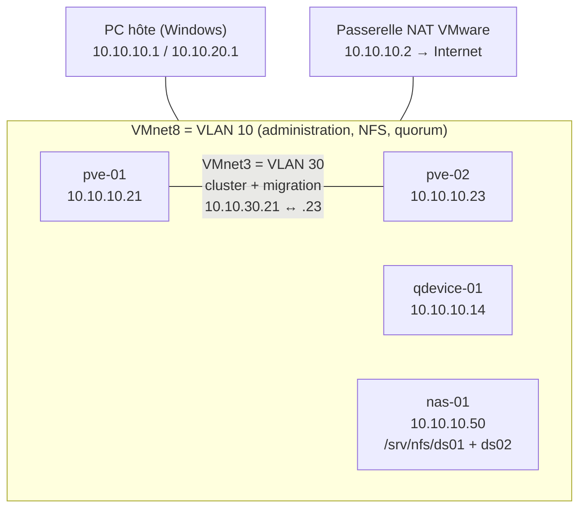

| Machine | Nom complet | Adresse | Carte | Réseau VMware |
|---|---|---|---|---|
| pve-01 (administration, `vmbr0`) | pve-01.satom.lab | 10.10.10.21/24 | nic0 | VMnet8 |
| pve-01 (cluster, `vmbr1`) | — | 10.10.30.21/24 | nic1 | VMnet3 |
| pve-02 (administration, `vmbr0`) | pve-02.satom.lab | 10.10.10.23/24 | nic0 | VMnet8 |
| pve-02 (cluster, `vmbr1`) | — | 10.10.30.23/24 | nic1 | VMnet3 |
| qdevice-01 | qdevice-01.satom.lab | 10.10.10.14/24 | ens33 | VMnet8 |
| nas-01 | nas-01.satom.lab | 10.10.10.50/24 | ens33 | VMnet8 |

| Machine | Processeurs | RAM | Disques |
|---|---|---|---|
| pve-01 et pve-02 | 4 | 8 Go | 64 Go |
| nas-01 | 1 | 1 Go | 16 Go (système) + 2 × 20 Go (ds01, ds02) |
| qdevice-01 | 1 | 1 Go | 8 Go |

### 2.5 Méthode de travail

- Chaque commande est tapée à la main après avoir compris son rôle, puis **vérifiée** par une commande de contrôle (`ip a`, `ping`, `df -h`, `exportfs -v`…).
- Avant de modifier un fichier de configuration, j'en fais une **copie de sauvegarde** (`cp fichier fichier.bak`), et je **relis** le fichier avant de l'appliquer.
- Ce TP a été préparé et guidé avec l'aide de Claude (une IA), utilisé comme support d'apprentissage.

---

## 3. Les réseaux virtuels

Avant d'installer quoi que ce soit, j'ai créé les trois réseaux dans l'**Éditeur de réseau virtuel** de VMware (menu Modifier). Tous les serveurs se branchent dessus.

Le réseau **VMnet8** existait déjà, en mode NAT. Je lui ai donné le sous-réseau `10.10.10.0/24` du plan d'adressage. C'est le VLAN 10 : administration des nœuds, NFS et quorum.

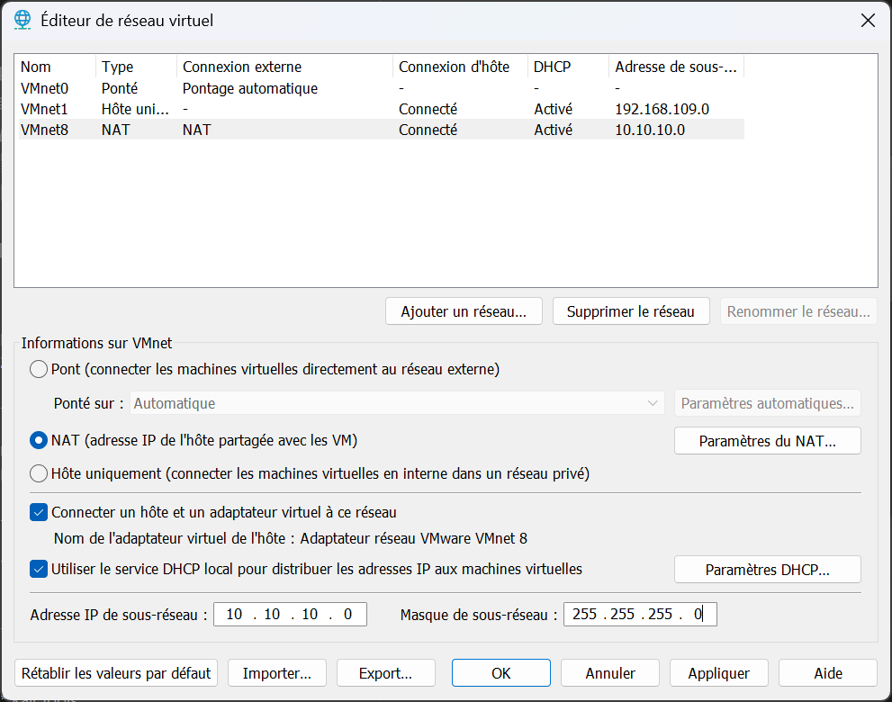

VMnet8 est en mode **NAT** sur `10.10.10.0` avec le DHCP actif. Le DHCP ne distribue que les adresses `.128` à `.254`, donc il ne gêne pas les adresses fixes du plan (`.14`, `.21`, `.23`, `.50`).

Pour le **VLAN 30**, le réseau du cluster, j'ai créé **VMnet3** en « Hôte uniquement », **sans** adaptateur hôte et **sans** DHCP.

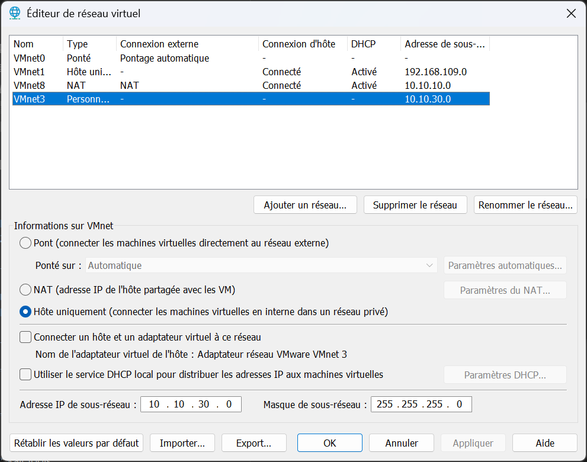

La colonne « Connexion d'hôte » affiche `-` : le PC n'a pas d'adresse sur ce réseau. Seuls les deux nœuds s'y parlent. C'est voulu : **Corosync**, le système qui permet aux nœuds de se surveiller en permanence, est très sensible aux retards. On l'isole donc du reste du trafic.

Pour le **VLAN 20**, le réseau des VM, j'ai créé **VMnet2** en « Hôte uniquement », **avec** l'adaptateur hôte et sans DHCP.

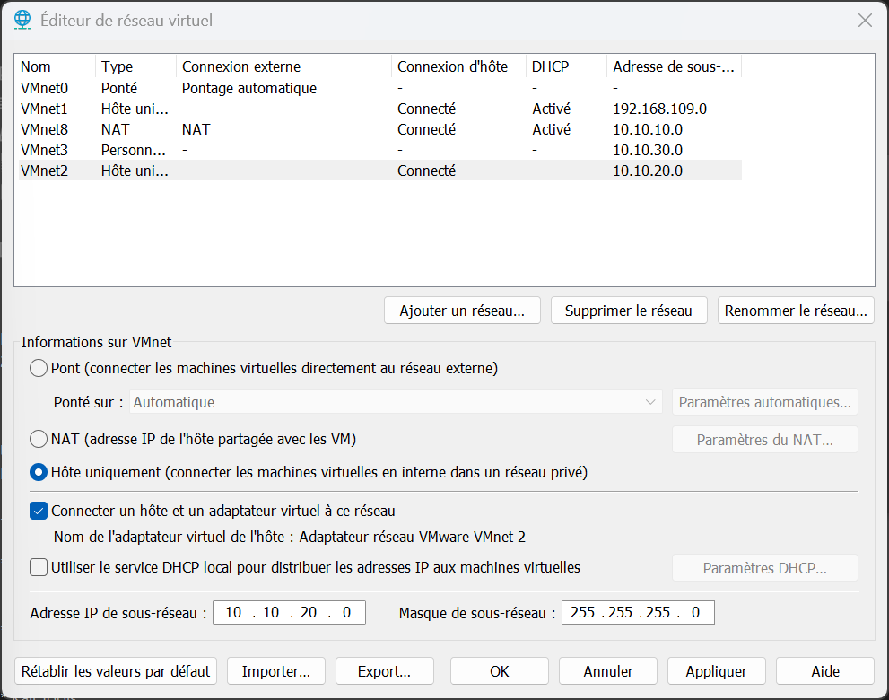

Ici, le PC prend l'adresse `10.10.20.1`. Elle servira de cible au ping continu pendant la migration à chaud (tâche 6).

---

## 4. Tâche 1 — Installation des nœuds

### 4.1 Préparation des VM

Les VM PVE-01 et PVE-02 existaient déjà (8 Go de RAM, 4 processeurs, 64 Go de disque). Je les ai reprises en ajoutant une carte réseau par VLAN. Pour PVE-01 :

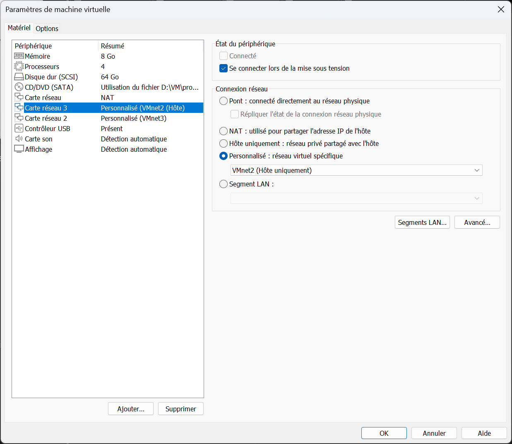

PVE-01 a trois cartes : **NAT** (VLAN 10), **VMnet3** (VLAN 30) et **VMnet2** (VLAN 20). Sur un vrai serveur, ce seraient trois ports réseau physiques.

PVE-02 a reçu exactement la même configuration. Dans un cluster, les nœuds doivent être identiques, pour qu'un nœud puisse accueillir les VM de l'autre sans surprise.

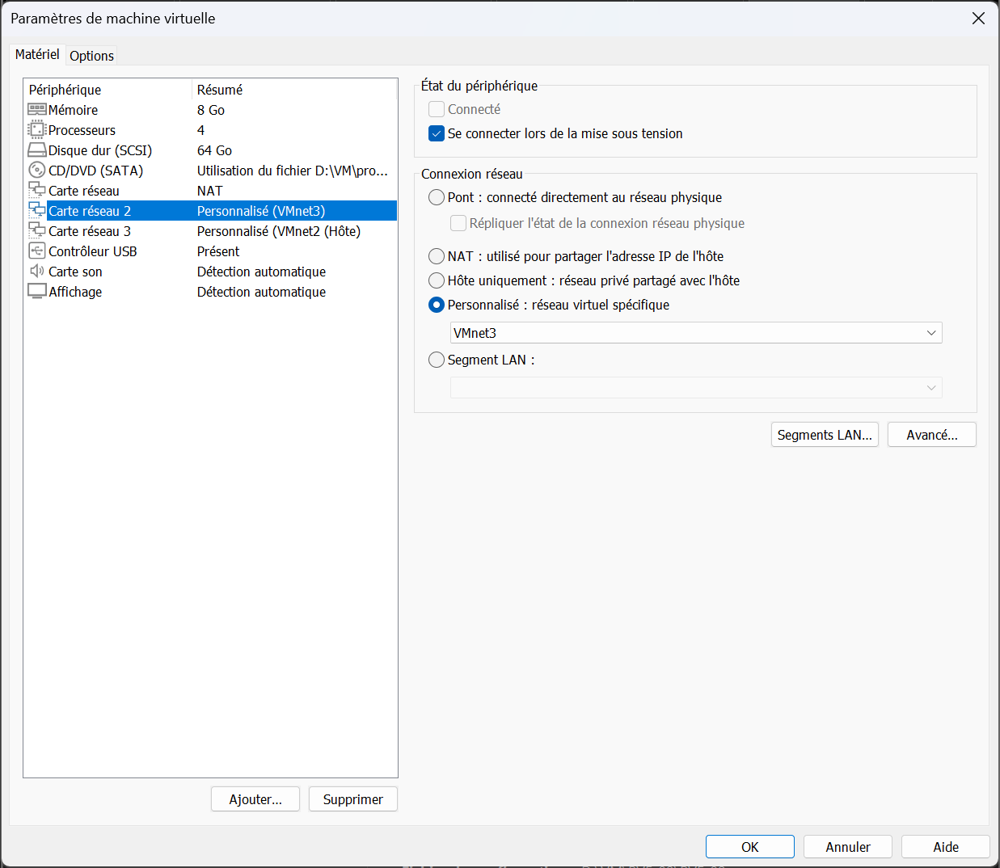

Les cartes 2 et 3 de PVE-02 sont bien sur VMnet3 et VMnet2, comme sur PVE-01.

### 4.2 Installation de Proxmox VE 9.2

L'ISO `proxmox-ve_9.2-1.iso` est montée dans le lecteur CD de la VM. Comme l'ancien disque contenait déjà un Proxmox, j'ai dû passer par le BIOS de la VM (« Mettre sous tension dans le microprogramme ») pour démarrer sur le CD en premier (voir *Problèmes rencontrés*).

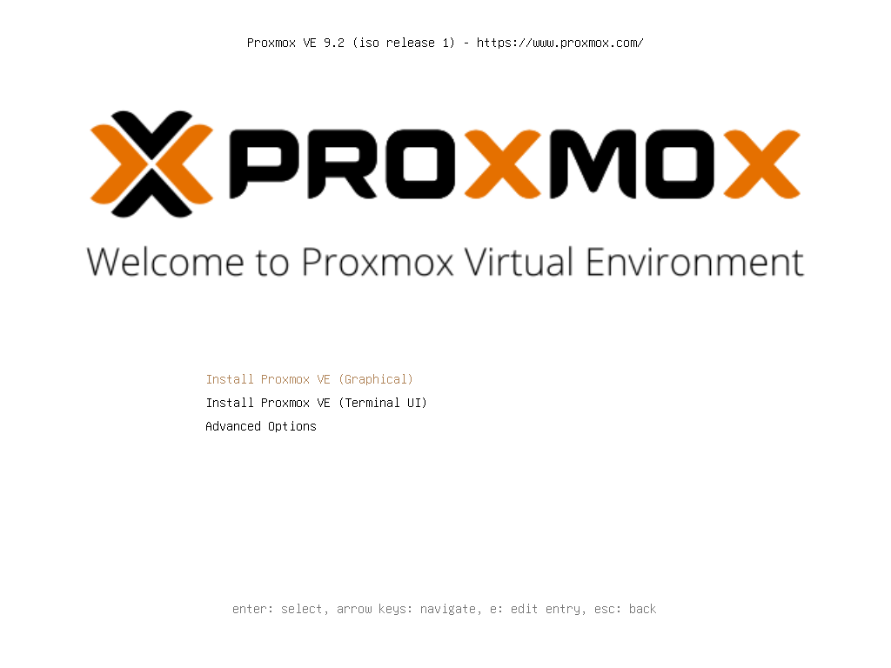

C'est le menu de l'installateur Proxmox VE 9.2. J'ai choisi l'installation graphique.

Au lancement, l'installateur affiche un avertissement :

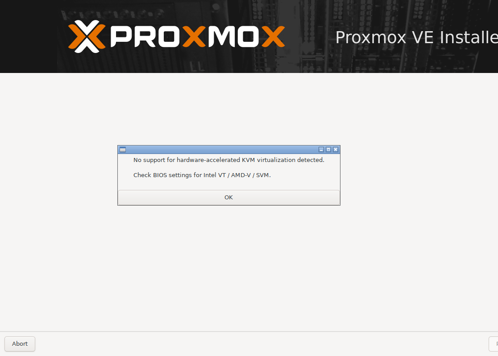

« No support for hardware-accelerated KVM virtualization detected » : Proxmox ne trouve pas les fonctions VT-x du processeur. C'est la conséquence attendue du choix expliqué en 2.2. L'installation continue normalement, et les VM de Proxmox tourneront en émulation.

Sur l'écran réseau, j'ai saisi les valeurs du plan d'adressage :

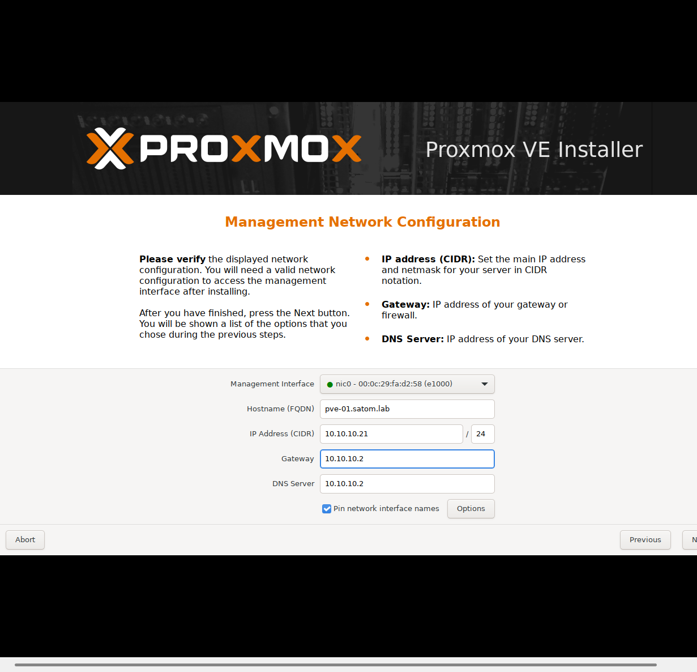

L'interface de management est **nic0** (la carte NAT). Le nom est `pve-01.satom.lab` (FQDN : nom de la machine + domaine), l'adresse `10.10.10.21/24`, la passerelle et le DNS `10.10.10.2`. Proxmox 9 nomme les cartes `nic0`, `nic1`, `nic2` et « épingle » ces noms. Ainsi, une mise à jour du système ne peut pas renommer une carte et couper le serveur du réseau.

Avant de lancer l'installation, le récapitulatif permet de tout vérifier :

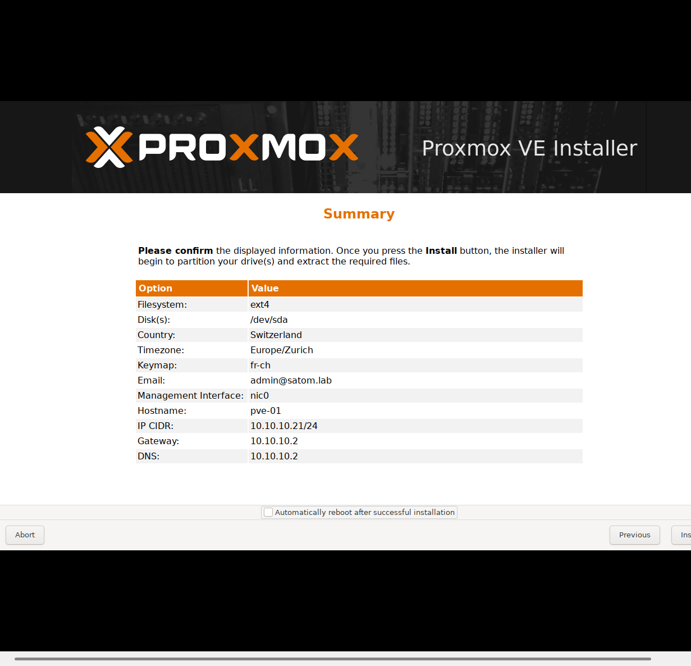

Système de fichiers ext4 sur `/dev/sda`, fuseau Europe/Zurich, clavier fr-ch, nic0, `10.10.10.21/24` : tout correspond. J'ai décoché le redémarrage automatique pour pouvoir débrancher l'ISO avant de redémarrer.

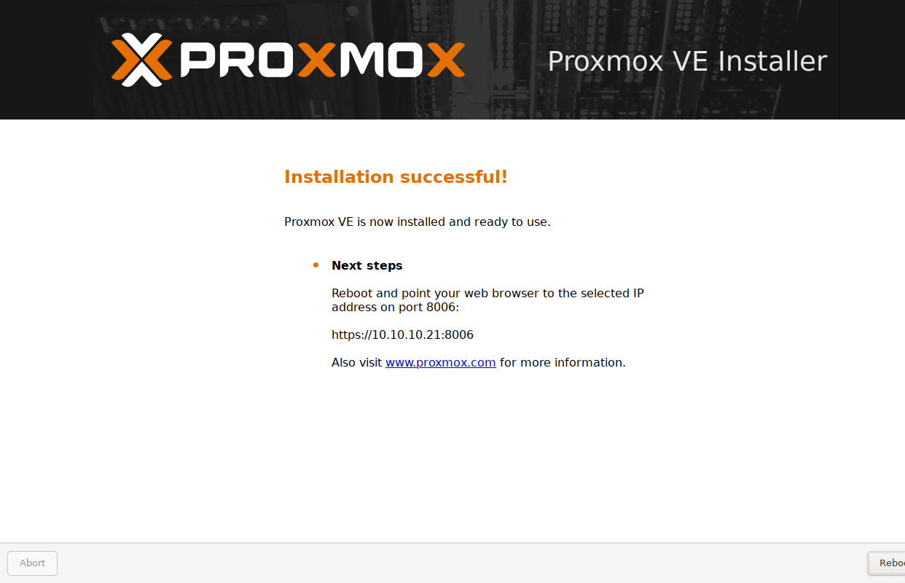

L'installation est terminée. L'écran indique déjà l'adresse de l'interface web : `https://10.10.10.21:8006`.

pve-02 a été installé de la même façon. Seuls le nom et l'adresse changent :

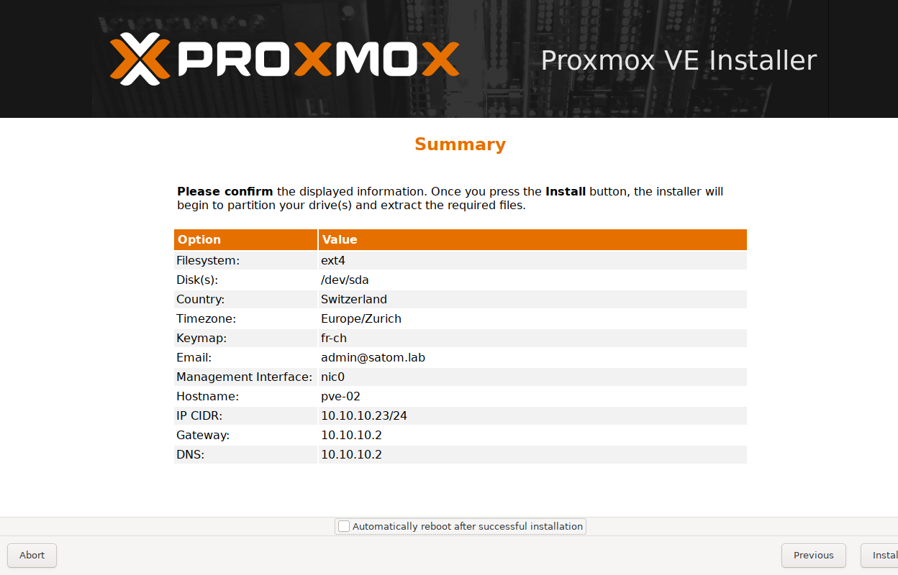

`pve-02`, `10.10.10.23/24` : conforme au plan d'adressage.

### 4.3 Premier démarrage et interface web

Après avoir débranché l'ISO, chaque nœud démarre sur son disque et affiche sa console :

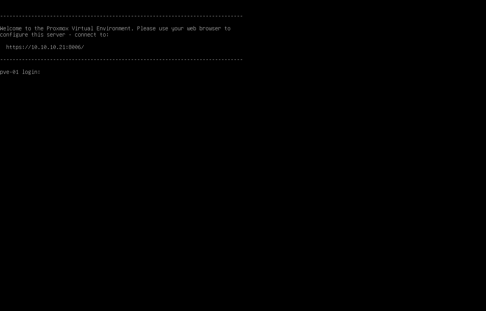

pve-01 démarre et affiche `https://10.10.10.21:8006/` et `pve-01 login:`. Le nœud est opérationnel.

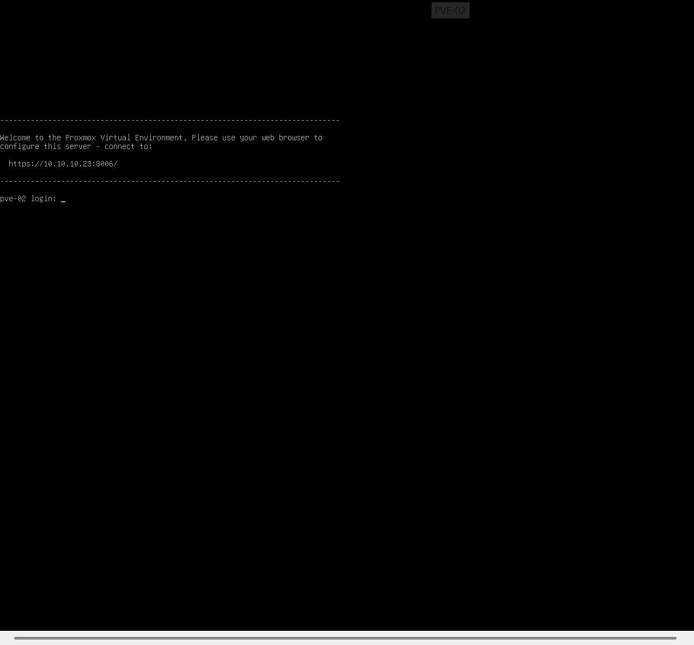

pve-02 démarre lui aussi sur son disque, avec `https://10.10.10.23:8006/`.

**Comprendre l'adresse `https://10.10.10.21:8006` :** `https` est le protocole web chiffré, `10.10.10.21` l'adresse IP du nœud, et `8006` le **port**, la « porte » sur laquelle l'interface de Proxmox écoute. Le port est le même sur toutes les installations Proxmox. Si on a oublié l'IP d'un nœud, la console l'affiche au démarrage, ou on la retrouve avec `ip a` (ligne `inet` sous `vmbr0`).

Je me suis connecté à l'interface web depuis le navigateur du PC hôte, avec le compte `root` et le domaine « Linux PAM » :

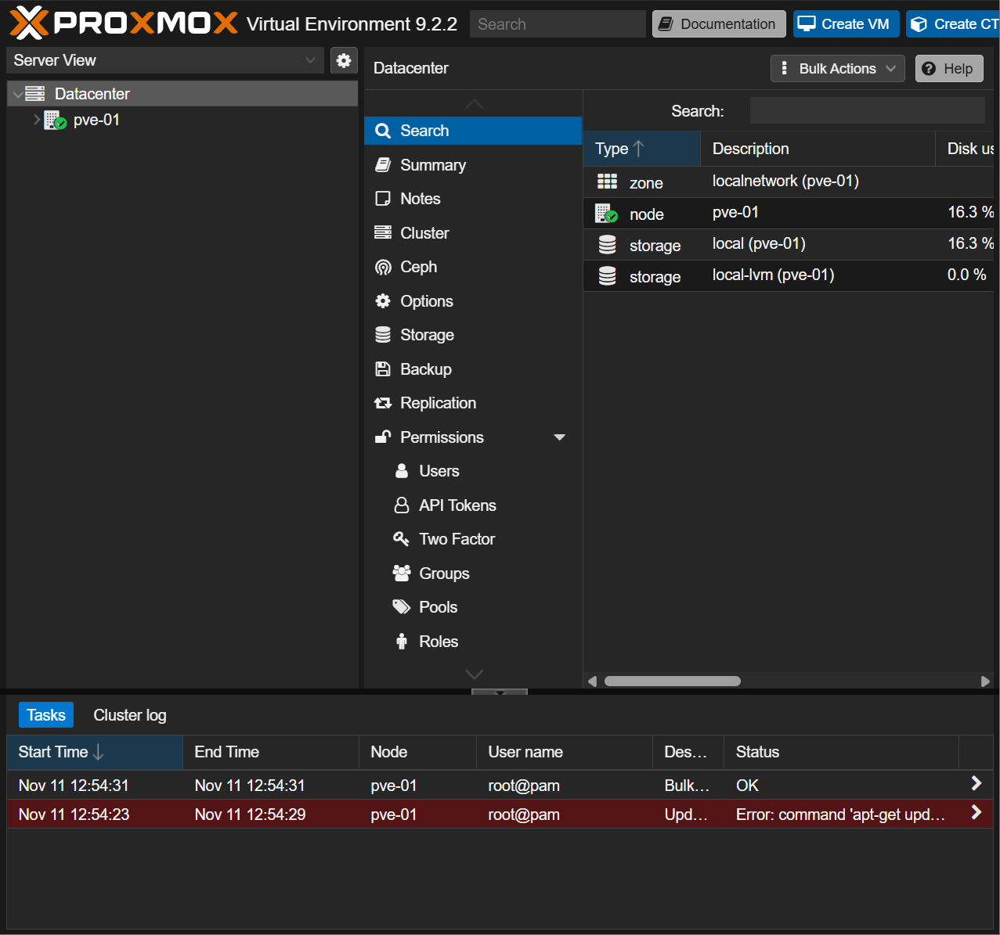

À gauche, l'arbre Datacenter → pve-01. À droite, les stockages par défaut : `local` (ISO et modèles) et `local-lvm` (disques de VM). En bas, le journal des tâches. Une première erreur y est déjà visible, traitée au point suivant.

### 4.4 Tâche 1.2 — Dépôts « no-subscription » et mises à jour

Le journal indique une erreur sur la mise à jour automatique de la liste des paquets :

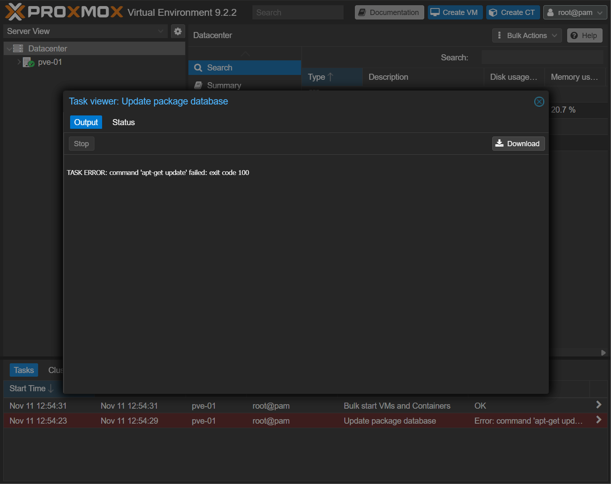

Le message « exit code 100 » dit seulement que la commande a échoué, sans donner la cause. Pour la trouver, j'ai relancé la même commande à la main dans le Shell du nœud :

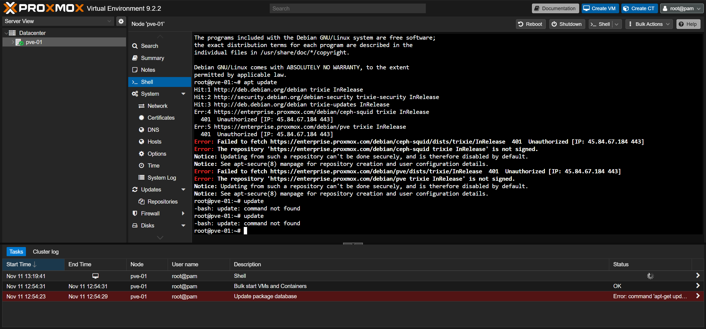

Les dépôts Debian répondent (`Hit`), donc **Internet fonctionne**. En revanche, les dépôts `enterprise.proxmox.com` renvoient **`401 Unauthorized`** : ils sont réservés aux clients qui ont un abonnement payant. Un **dépôt** est un serveur qui stocke les logiciels et leurs mises à jour, et `apt` est l'outil de Debian qui va les chercher.

**Solution (tâche 1.2) :** dans *pve-01 → Updates → Repositories*, j'ai désactivé les deux dépôts enterprise (pve et ceph-squid) et ajouté le dépôt gratuit **No-Subscription**.

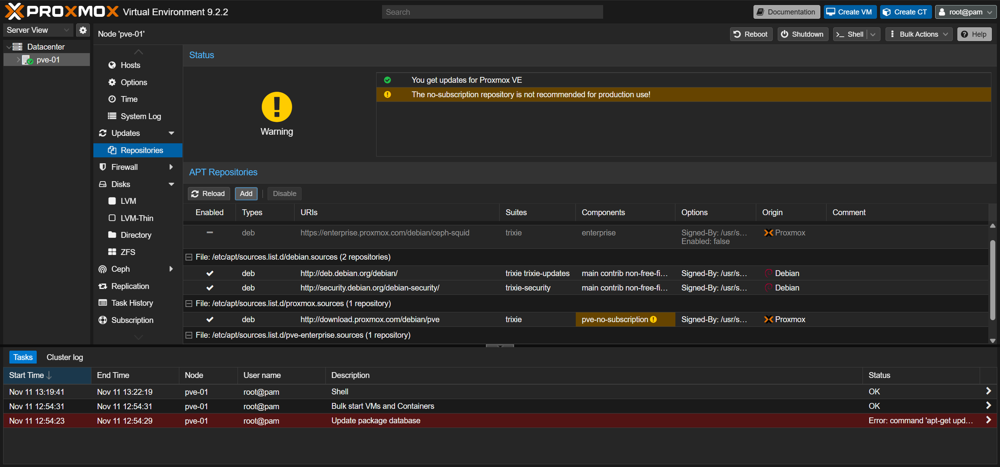

« You get updates for Proxmox VE » : le nœud reçoit à nouveau ses mises à jour. Le bandeau orange rappelle que ce dépôt n'est pas recommandé en production. C'est un choix normal pour un labo, alors qu'une entreprise en production prendrait un abonnement. Ces réglages sont stockés dans de simples fichiers texte, dans `/etc/apt/sources.list.d/`.

La même correction a été faite sur pve-02 :

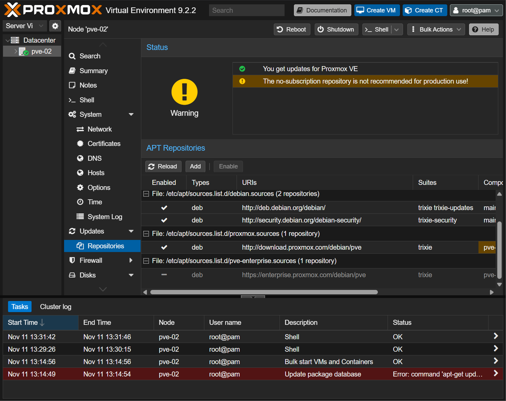

Sur pve-02 aussi, `pve-no-subscription` est activé et le dépôt enterprise est désactivé (tiret « — »).

Ensuite, sur chaque nœud : `apt update` (télécharger la **liste** des paquets disponibles), puis `apt full-upgrade` (installer les nouvelles versions, en autorisant l'ajout ou le retrait de paquets si nécessaire, comme le recommande Proxmox). Vérification avec `pveversion` et `apt list --upgradable` :

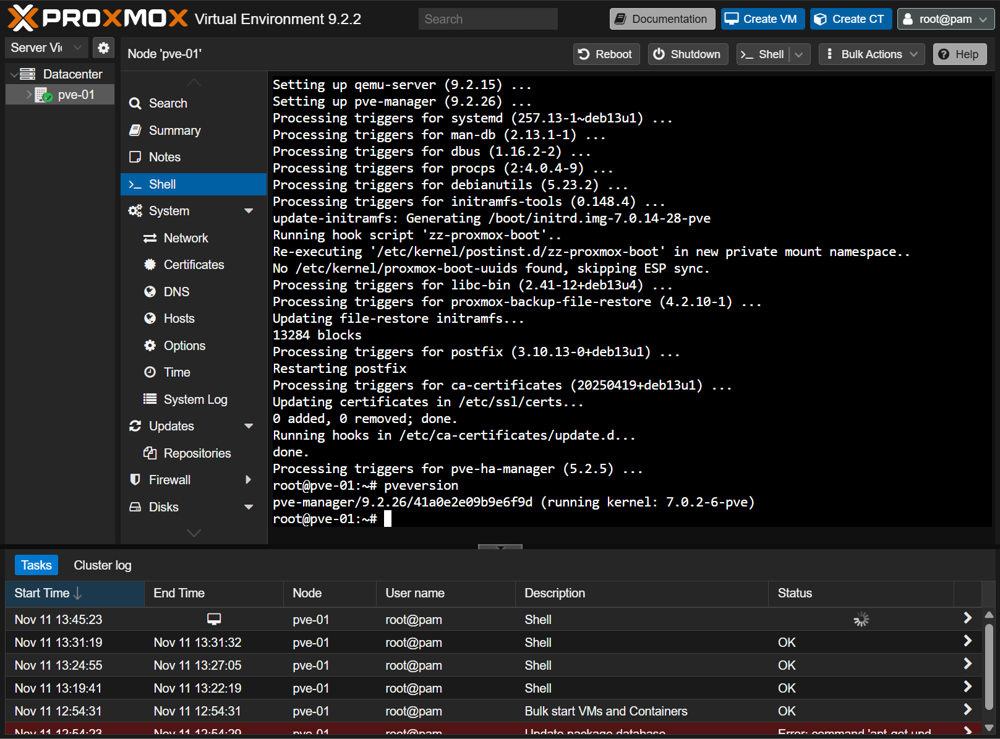

pve-01 affiche `pve-manager/9.2.26`. Un nouveau noyau (`7.0.14-28`) a été installé, mais le nœud tourne encore sur l'ancien (`running kernel: 7.0.2-6`) : un nouveau noyau n'est utilisé qu'après un redémarrage.

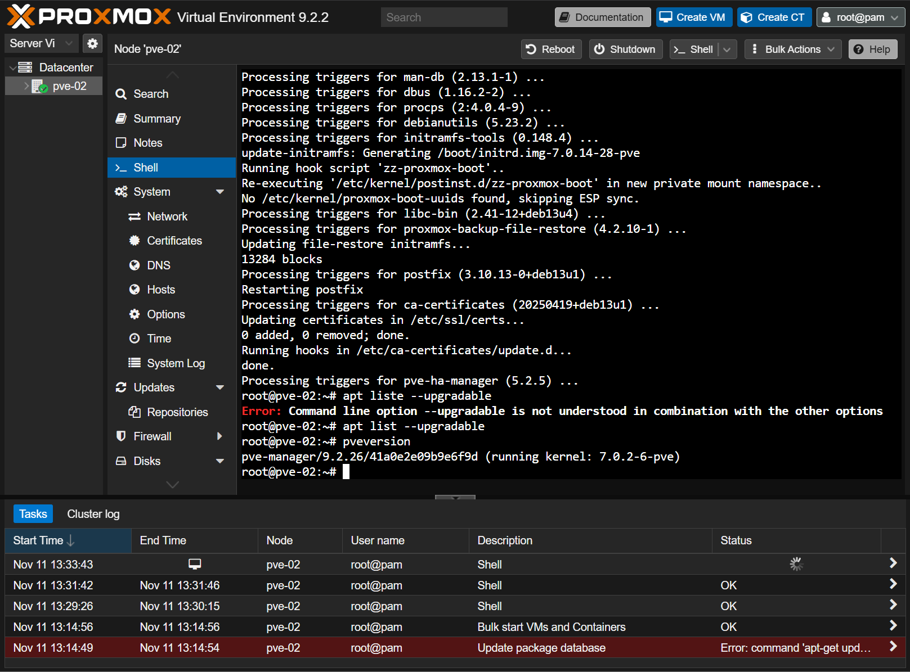

Sur pve-02, `apt list --upgradable` ne renvoie plus rien : aucune mise à jour en attente. Lui aussi est en **9.2.26**. Les deux nœuds ont la **même version**, condition indispensable avant de les réunir en cluster. Ils ont ensuite été redémarrés pour charger le nouveau noyau.

### 4.5 Tâche 1.3 — Le réseau du cluster (`vmbr1`)

Un **bridge** (pont) est un switch virtuel à l'intérieur de Proxmox. `vmbr0`, créé à l'installation, porte l'administration. J'ai créé `vmbr1` sur la carte `nic1` (VMnet3) pour le cluster et les migrations : *pve-01 → System → Network → Create → Linux Bridge*.

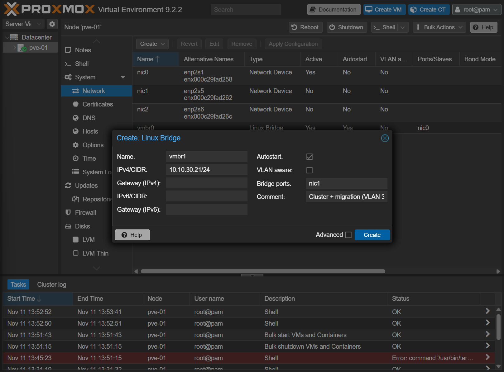

`10.10.30.21/24`, **sans passerelle** : ce réseau ne sort jamais vers Internet, et un serveur ne doit avoir qu'une seule passerelle (celle de vmbr0). Port `nic1`. « Autostart » est coché pour que le bridge revienne après un redémarrage. « VLAN aware » est décoché, puisque chaque VLAN a sa propre carte.

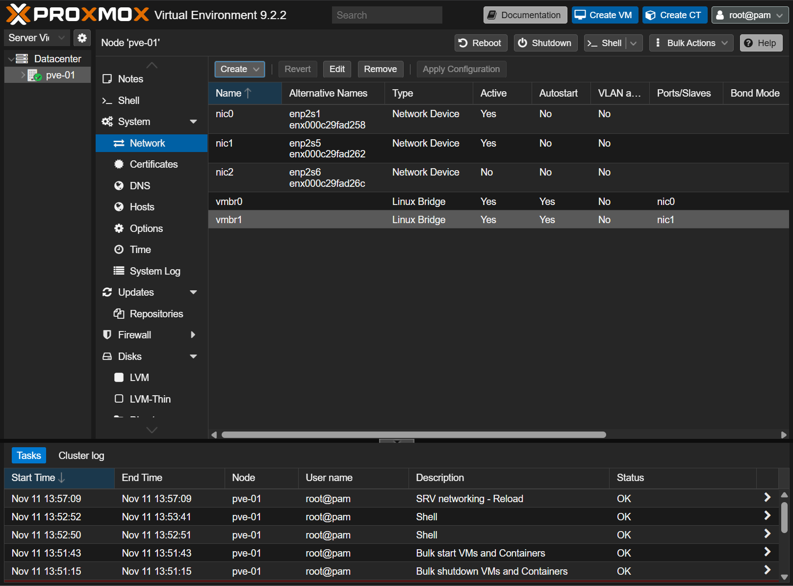

Après « Apply Configuration », `vmbr1` est actif (Active : Yes) sur `nic1`, qui est passée elle aussi à Active : Yes. La configuration est écrite dans le fichier `/etc/network/interfaces` du nœud.

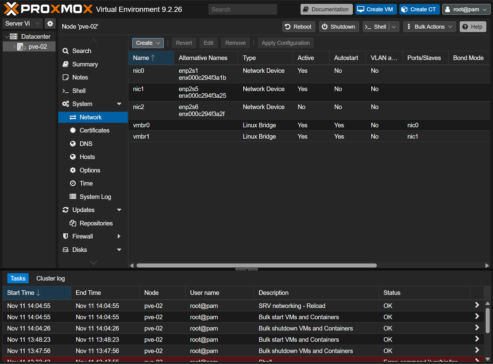

Même configuration sur pve-02, avec l'adresse `10.10.30.23/24`.

### 4.6 Tâche 1.4 — Test de connectivité sur le réseau du cluster

Mon premier test était faux, et il est instructif :

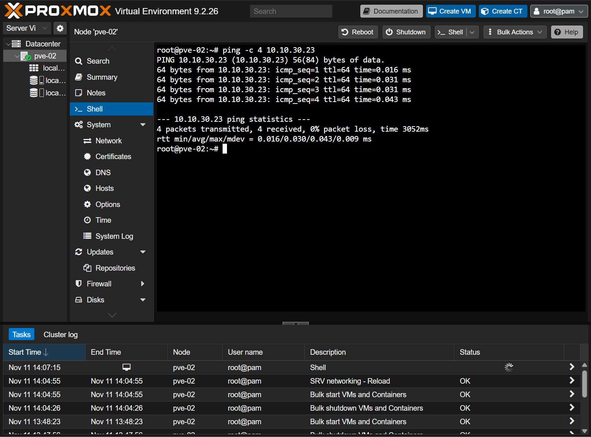

Depuis pve-02, j'ai pingé `10.10.30.23`, c'est-à-dire **sa propre adresse**. La machine s'est répondu à elle-même. L'indice : un temps de **0,016 ms**, bien trop court pour un vrai trajet réseau. Ce test ne prouve rien sur le lien entre les deux nœuds.

Le bon test, demandé par l'énoncé : `ping -c 4 10.10.30.23` **depuis pve-01**. L'option `-c 4` envoie 4 paquets puis s'arrête.

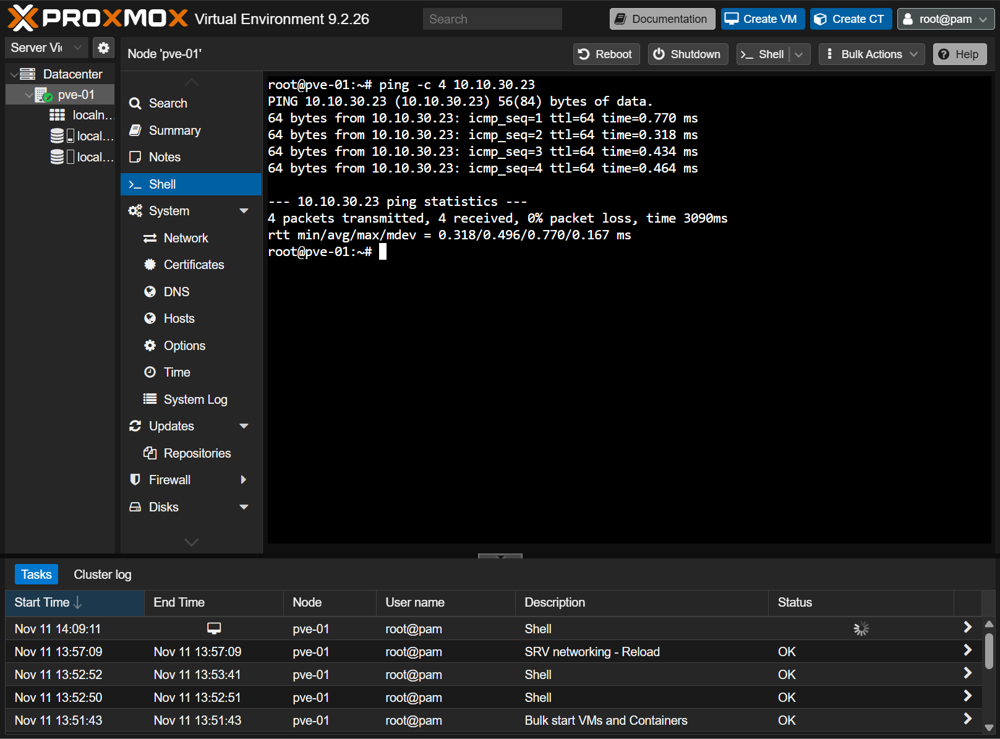

4 paquets envoyés, 4 reçus, **0 % de perte**, avec des temps entre 0,3 et 0,8 ms : c'est un vrai aller-retour par VMnet3. Le réseau du cluster fonctionne. **La tâche 1 est terminée.**

---

## 5. Prérequis — Stockage partagé (nas-01) et arbitre (qdevice-01)

L'énoncé suppose que le NAS et le QDevice existent déjà. Sans serveur de l'école, je les ai créés moi-même : deux VM **Debian 12**, installées depuis l'ISO `debian-12.15.0-amd64-netinst.iso`. *Netinst* veut dire que l'ISO est petite et télécharge le reste depuis Internet pendant l'installation.

### 5.1 nas-01 — Installation

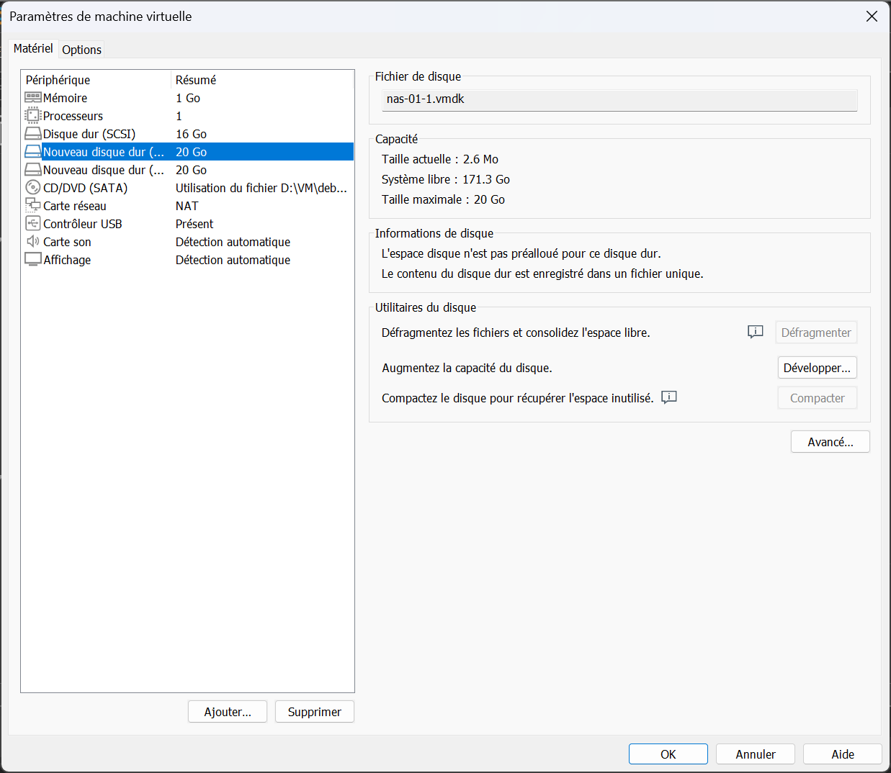

nas-01 a 1 Go de RAM, 1 processeur, un disque système de 16 Go et **deux disques de données de 20 Go** (ds01 et ds02). Les données sont séparées du système : on peut réinstaller le système sans toucher aux données. On voit « Taille actuelle : 2.6 Mo » pour une taille maximale de 20 Go : c'est l'**allocation dynamique** (thin provisioning). Le fichier du disque ne grossit qu'au fur et à mesure qu'il se remplit.

Au partitionnement, il fallait installer Debian sur le **disque système** (`sda`), et pas sur un disque de données :

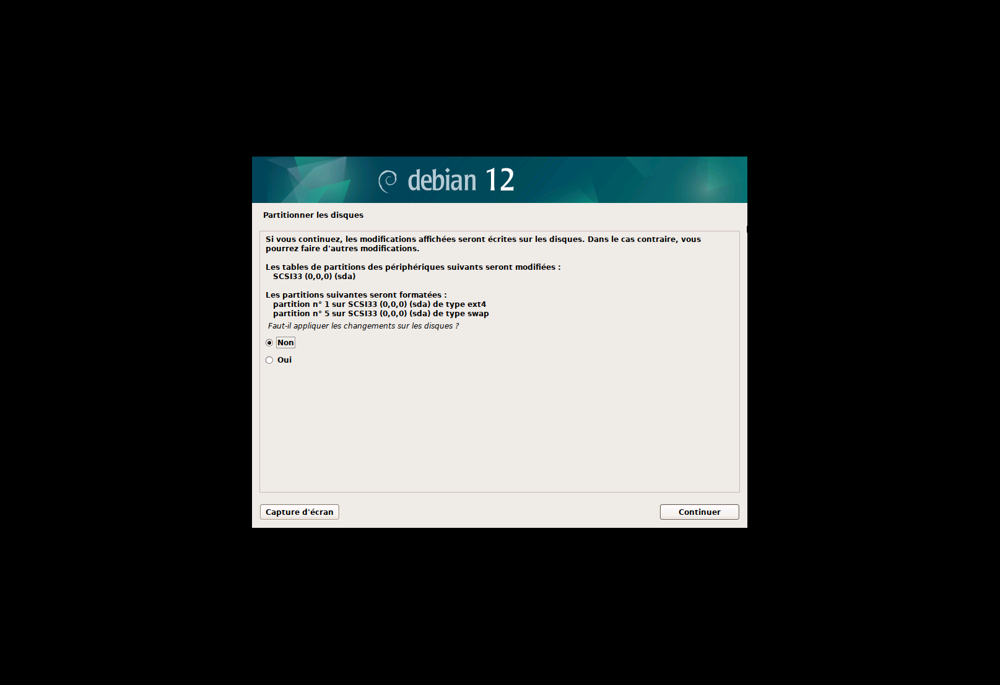

Seul `sda` est modifié : une partition en ext4 (le format de fichiers standard de Linux) et une partition de **swap** (zone de secours quand la RAM est pleine).

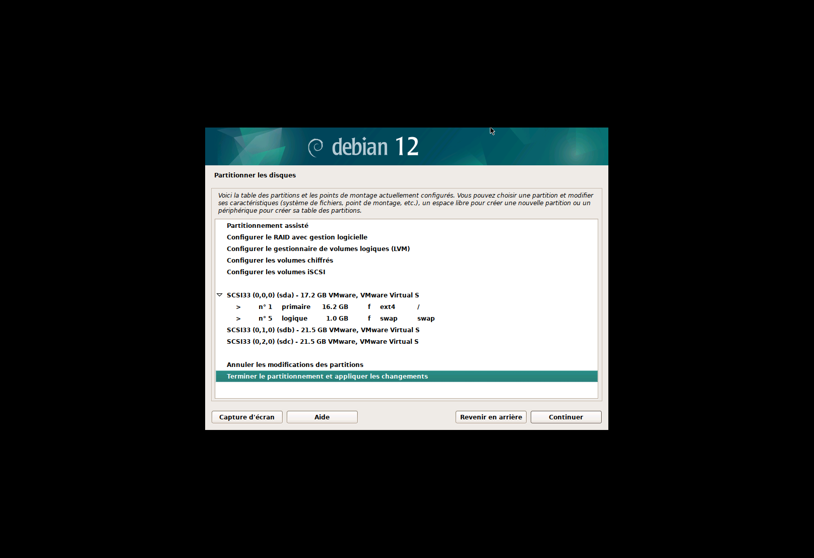

Le tableau confirme : `sda` contient ext4 monté sur `/` (la racine, l'équivalent de `C:\`) et la swap, tandis que `sdb` et `sdc` (21,5 GB) restent intacts. Debian compte en GB (10⁹ octets) et VMware en Gio (2³⁰ octets) : 20 Gio = 21,5 GB.

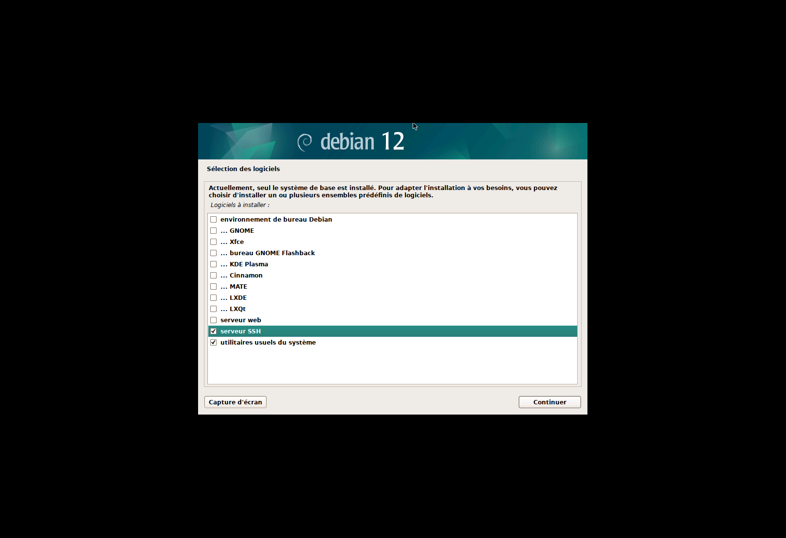

Seuls le **serveur SSH** (administration à distance) et les **utilitaires usuels** sont installés. Il n'y a pas d'interface graphique. C'est le principe de **surface d'attaque minimale** : moins de logiciels, c'est moins de failles possibles et moins de mémoire utilisée.

### 5.2 nas-01 — Adresse IP fixe

Après l'installation, nas-01 avait reçu une adresse du DHCP :

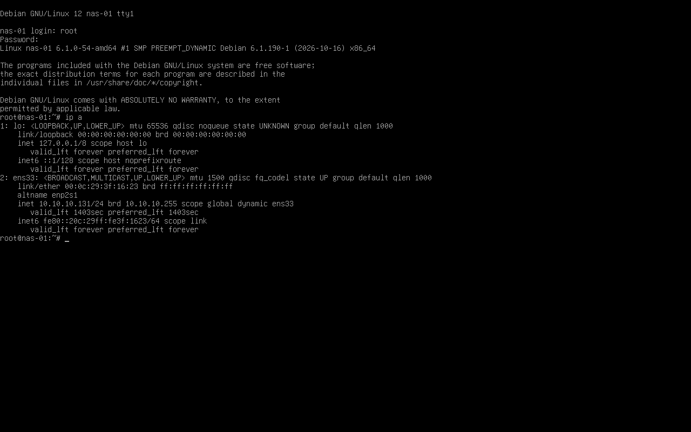

`inet 10.10.10.131/24 … dynamic`, avec `valid_lft 1403sec` : l'adresse est **prêtée** pour une durée limitée et peut changer. Un NAS doit garder une adresse fixe, puisque les nœuds iront chercher leurs disques à une adresse précise.

J'ai donc sauvegardé puis modifié `/etc/network/interfaces` avec l'éditeur `nano` :

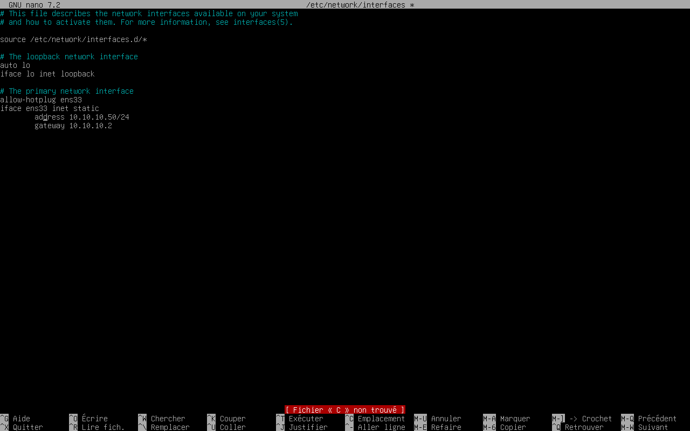

| Ligne | Rôle |
|---|---|
| `allow-hotplug ens33` | Activer la carte dès qu'elle est détectée |
| `iface ens33 inet static` | Adresse IPv4 **fixe** (au lieu de `dhcp`) |
| `address 10.10.10.50/24` | L'adresse du plan d'adressage |
| `gateway 10.10.10.2` | La passerelle vers Internet |

Après un redémarrage :

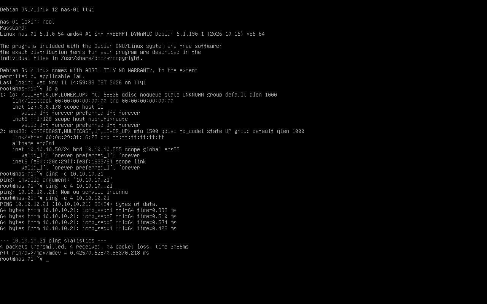

`inet 10.10.10.50/24` sans « dynamic », avec `valid_lft forever` : l'adresse est fixe. Le ping vers pve-01 répond (0 % de perte), donc nas-01 est sur le même réseau que les nœuds. On voit aussi deux erreurs de syntaxe sur `ping` avant la bonne commande (voir *Problèmes rencontrés*).

### 5.3 nas-01 — Disques de données et partages NFS

Avant de formater, j'ai vérifié les disques avec `lsblk` (*list block devices*) :

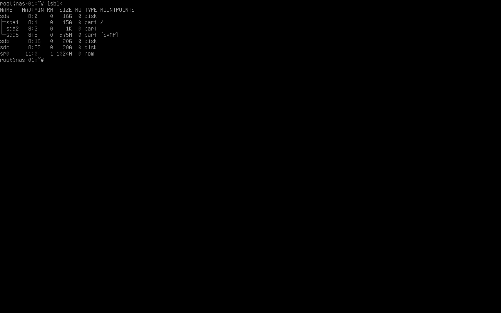

`sda` porte le système. `sdb` et `sdc` (20G) n'ont aucune partition et ne sont montés nulle part : ce sont bien les disques à formater. Cette vérification évite d'effacer le mauvais disque.

J'ai ensuite installé le serveur NFS (`apt install nfs-kernel-server`) et formaté les deux disques en leur donnant une **étiquette** :

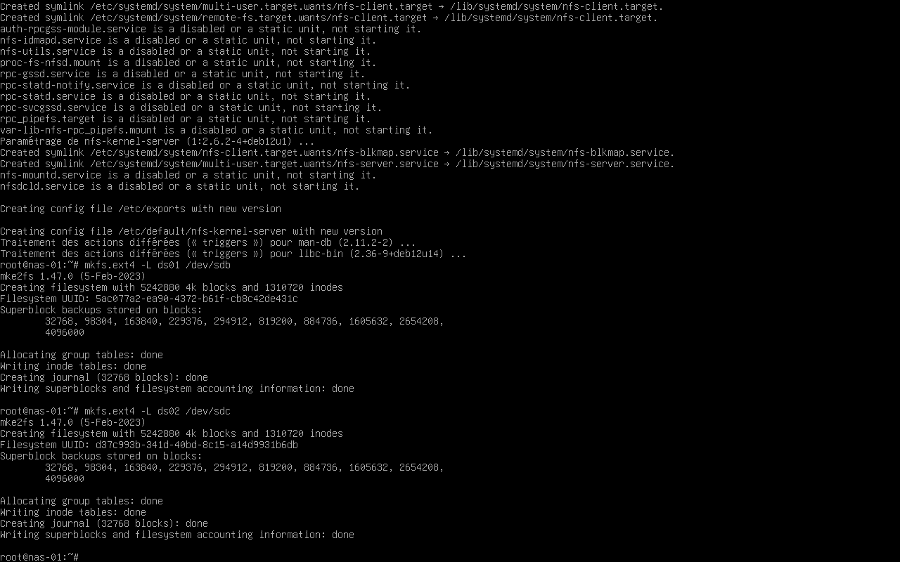

« Creating config file /etc/exports » confirme l'installation du serveur NFS. `mkfs.ext4 -L ds01 /dev/sdb` et `mkfs.ext4 -L ds02 /dev/sdc` se terminent par « done ». Les messages « is a disabled or a static unit » ne sont pas des erreurs : ce sont des services NFS optionnels qui restent arrêtés.

Pour que les disques soient **montés** (accrochés à un dossier) à chaque démarrage, j'ai créé `/srv/nfs/ds01` et `/srv/nfs/ds02` (`mkdir -p`), puis ajouté deux lignes dans `/etc/fstab`, la table des disques montés automatiquement :

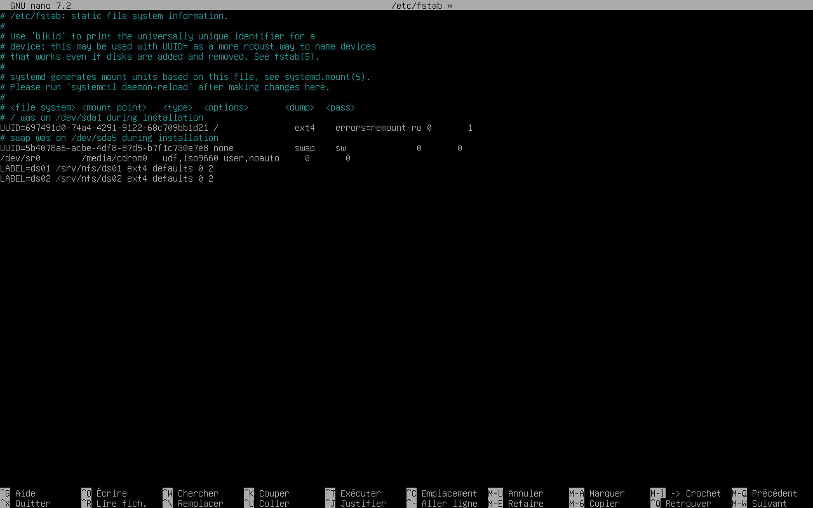

| Colonne | Exemple | Sens |
|---|---|---|
| Disque | `LABEL=ds01` | Désigné par son étiquette, qui ne change pas, contrairement à `/dev/sdb` |
| Point de montage | `/srv/nfs/ds01` | Le dossier auquel le disque est accroché |
| Type | `ext4` | Le format |
| Options | `defaults` | Lecture/écriture normales |
| dump / pass | `0 2` | Pas de sauvegarde `dump`. Vérification au démarrage après le disque système |

Puis `systemctl daemon-reload` (comme l'indique le commentaire en tête du fichier), `mount -a` pour tout monter, et `df -h` pour contrôler :

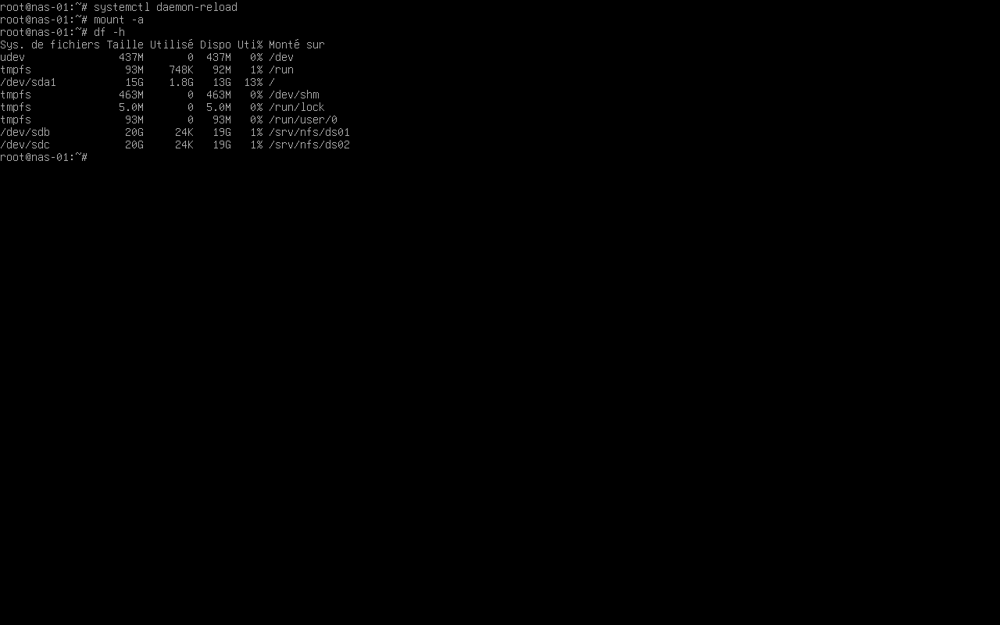

`/dev/sdb` est monté sur `/srv/nfs/ds01` et `/dev/sdc` sur `/srv/nfs/ds02`, 20G chacun. `mount -a` n'a affiché aucun message : sous Linux, l'absence de message signifie que tout s'est bien passé.

Enfin, le partage réseau. Le fichier `/etc/exports` déclare ce que le NAS partage, et avec qui :

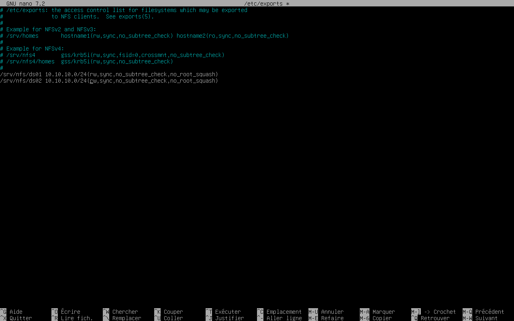

| Élément | Sens |
|---|---|
| `10.10.10.0/24` | Seul le réseau d'administration (les nœuds) a accès |
| `rw` | Lecture et écriture |
| `sync` | Le NAS ne confirme une écriture qu'une fois les données réellement sur le disque : plus sûr en cas de coupure |
| `no_subtree_check` | Désactive une vérification inutile (valeur recommandée) |
| `no_root_squash` | Proxmox travaille en root et doit pouvoir écrire. Ce compromis de sécurité est compensé par la restriction à `10.10.10.0/24` |

**Point d'attention :** aucun espace entre `/24` et la parenthèse. Avec un espace, les options s'appliqueraient à **tout le monde**, et le partage serait ouvert à n'importe qui.

Application avec `exportfs -ra`, puis vérification avec `exportfs -v` :

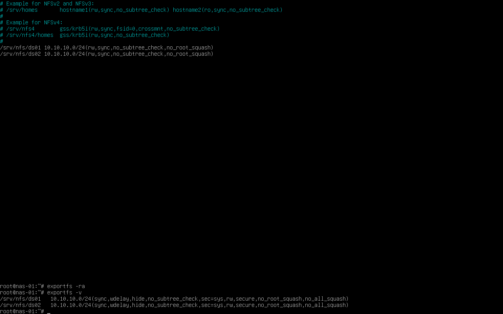

Les deux partages sont actifs et réservés à `10.10.10.0/24`. NFS affiche aussi ses options par défaut (`wdelay`, `hide`, `secure`…). **nas-01 est prêt** pour la tâche 3.

### 5.4 qdevice-01

Le QDevice est volontairement minimal, conformément au cahier des charges (1 vCPU, 1 Go de RAM) :

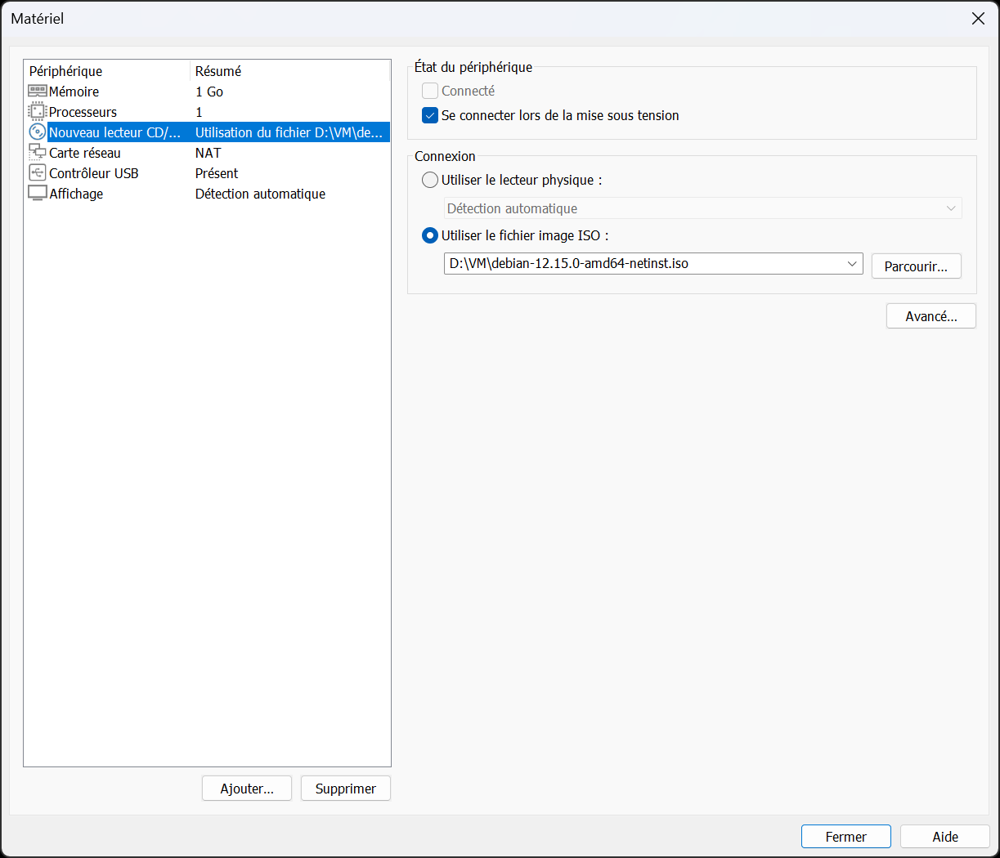

1 Go de RAM, 1 processeur, l'ISO Debian, le réseau NAT, et pas de carte son. On retire d'un serveur tout le matériel inutile.

Après l'installation, la machine portait un mauvais nom (« Lami »). Je l'ai corrigé sans réinstaller, avec `hostnamectl set-hostname qdevice-01` et en modifiant `/etc/hosts`, un annuaire local qui associe des noms à des adresses :

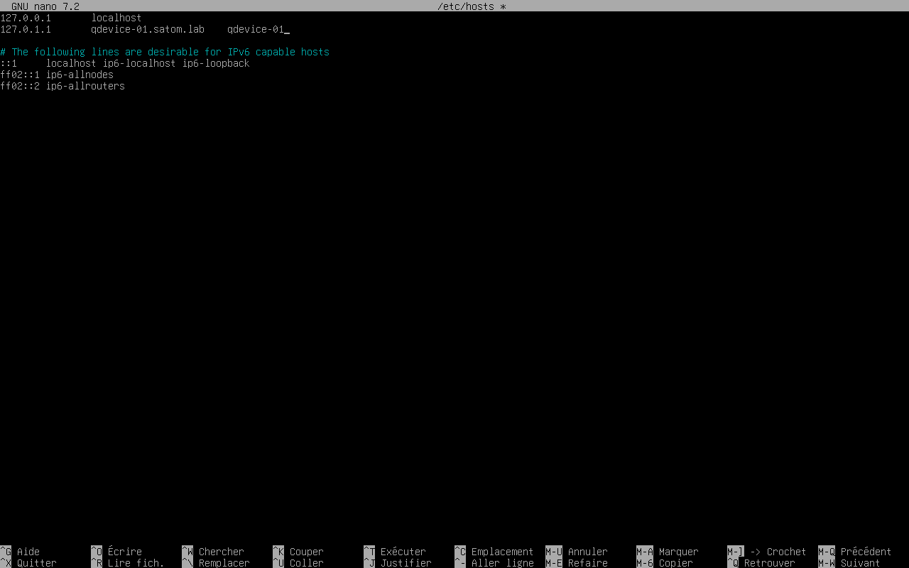

La ligne `127.0.1.1  qdevice-01.satom.lab  qdevice-01` donne à la machine son nom complet et son nom court. `127.0.1.1` est une adresse spéciale qui désigne la machine elle-même.

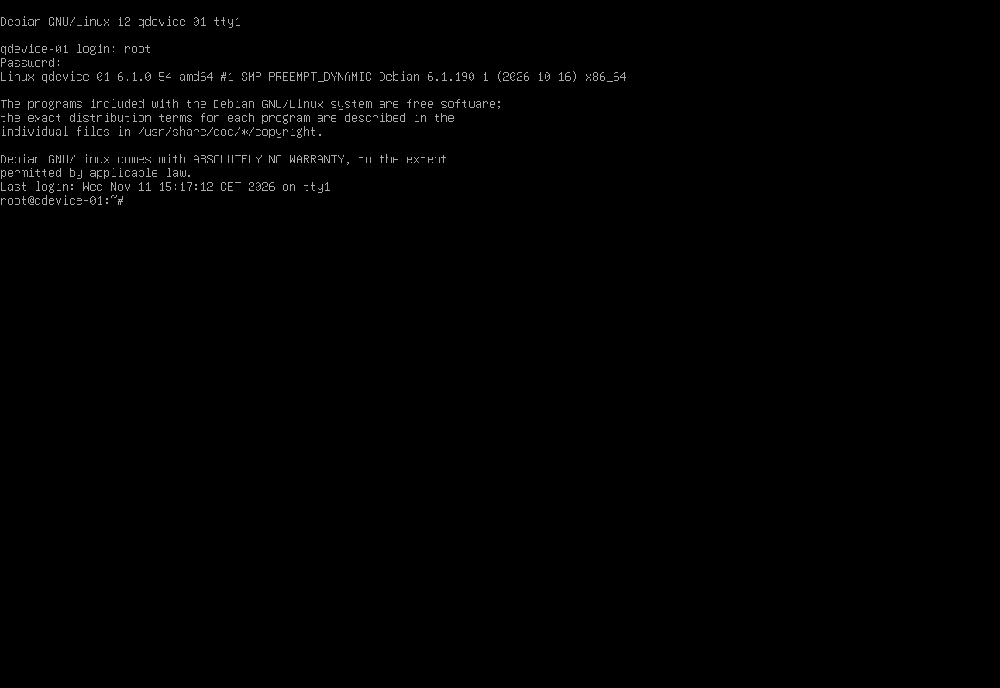

Après redémarrage, la console affiche `qdevice-01 login:` et `root@qdevice-01` : le nouveau nom est pris en compte.

L'adresse fixe a été configurée comme sur nas-01 :

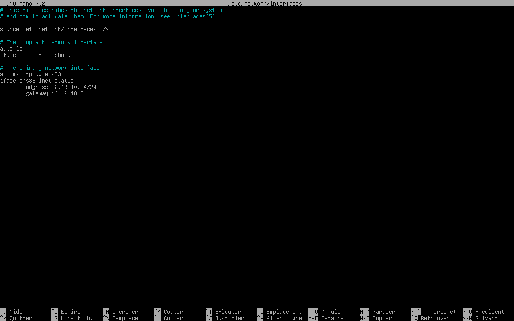

La configuration statique utilise `address 10.10.10.14/24` et `gateway 10.10.10.2`.

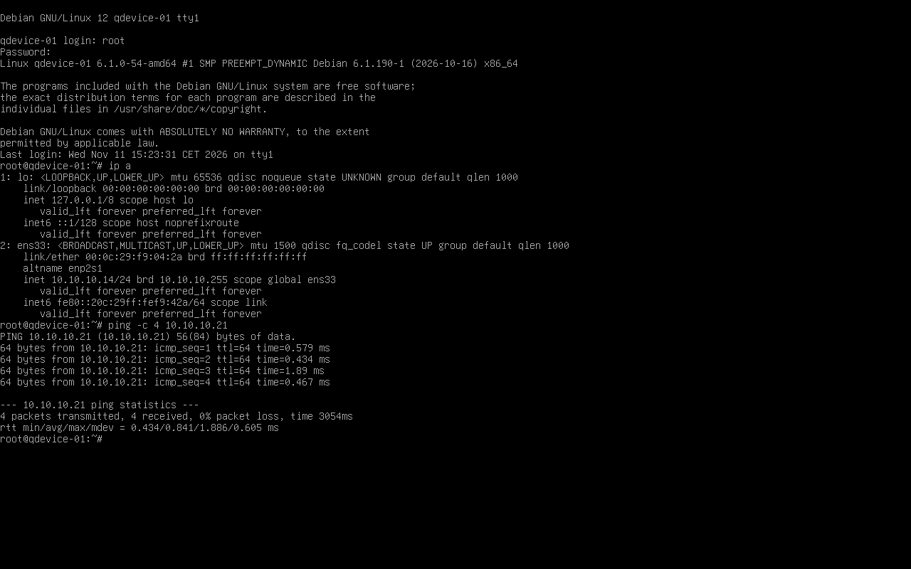

`inet 10.10.10.14/24`, `valid_lft forever`, et un ping vers pve-01 sans perte : **qdevice-01 est prêt** à devenir l'arbitre du cluster (tâche 2).

---

## 6. Tâche 2 — Cluster CL-Lab et QDevice

### 6.1 Les notions avant de commencer

- **Cluster** : un groupe de serveurs qui travaillent ensemble et se gèrent comme un seul. On administre tout depuis une seule interface, et les VM peuvent passer d'un serveur à l'autre.
- **Nœud** : un serveur membre du cluster. Ici, `pve-01` et `pve-02`. (*PVE* = *Proxmox Virtual Environment* ; la convention « rôle + numéro » rend le nom lisible par n'importe quel admin.)
- **Corosync** : le logiciel qui fait discuter les nœuds en permanence (« je suis vivant, je vote »). Il utilise le transport **knet** (*kronosnet*), chiffré et authentifié.
- **Quorum** : la majorité des voix. Un cluster n'a le droit d'agir (démarrer des VM, faire de la HA) que s'il a la majorité.
- **Split-brain** (« cerveau coupé ») : si le lien entre deux nœuds se coupe, chacun croit que l'autre est mort et pourrait démarrer les mêmes VM sur le même disque, ce qui corrompt les données. La règle du quorum l'empêche.
- **Arbitre (QDevice)** : avec 2 nœuds, la panne d'un seul donne 1 voix sur 2, pas de majorité, et tout se bloque. On ajoute donc une 3ᵉ voix légère, `qdevice-01`, qui ne fait tourner aucune VM. Avec 3 voix, le quorum est de 2 : le cluster survit à la perte d'un nœud.

### 6.2 L'arbitre : `corosync-qnetd` sur qdevice-01

Sur qdevice-01, j'ai installé le service d'arbitre avec `apt install corosync-qnetd`, puis vérifié qu'il tourne avec `systemctl status corosync-qnetd` :

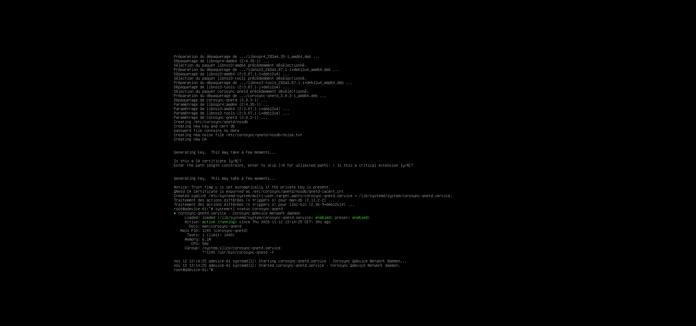

À l'installation, le paquet crée sa propre **autorité de certification** (« Creating new CA », `qnetd-cacert.crt`) : c'est elle qui signera plus tard le certificat du cluster. Le service est `active (running)` et `enabled`, donc il redémarrera automatiquement.

La commande `pvecm qdevice setup` se connecte en SSH avec le compte root pour copier les certificats. Debian l'interdit par défaut, j'ai donc ouvert l'accès **temporairement** dans `/etc/ssh/sshd_config` :

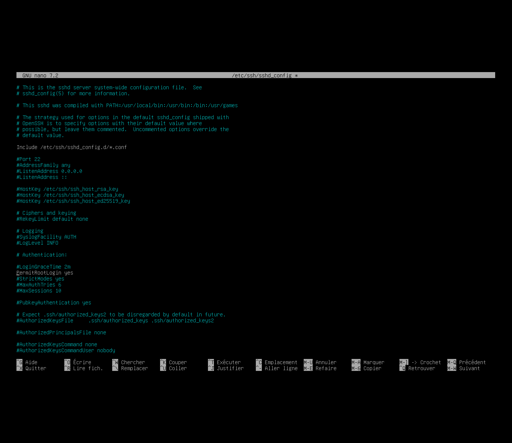

La ligne `PermitRootLogin yes` est décommentée, puis `systemctl restart ssh` l'applique. Cet accès est refermé à la fin de la tâche (6.5), car un root accessible en SSH par mot de passe est la première cible des attaques par force brute.

### 6.3 Le client QDevice sur les nœuds et la création du cluster

Chaque nœud a besoin du client `corosync-qdevice`, qui dialogue avec l'arbitre. Installation dans le Shell de pve-01 (puis pareil sur pve-02) :

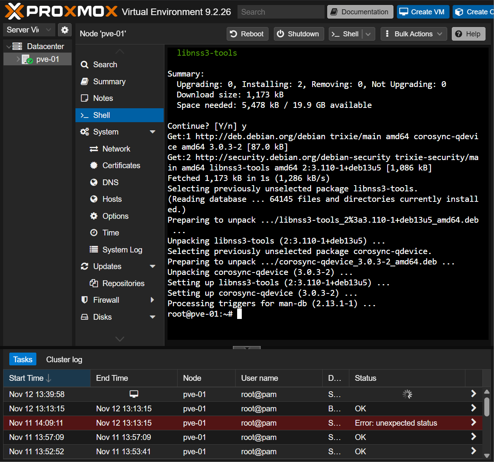

`Setting up corosync-qdevice (3.0.3-2)` : le paquet est installé, avec sa dépendance `libnss3-tools` (outils de certificats). Les nœuds sont basés sur Debian 13 *trixie*.

J'ai ensuite créé le cluster sur pve-01 avec `pvecm create CL-Lab --link0 10.10.30.21`. L'option `--link0` impose que Corosync passe par le **réseau cluster** (VLAN 30) et pas par le réseau d'administration. Vérification avec `pvecm status` :

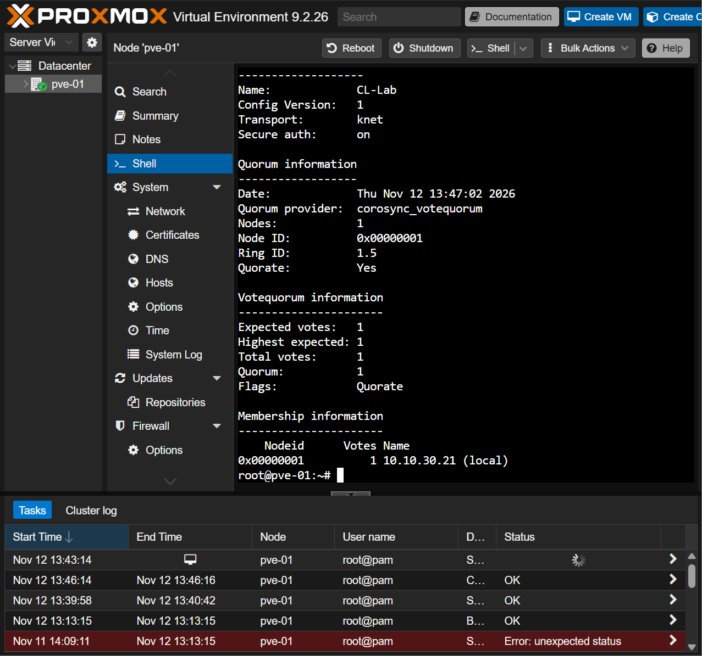

`Name: CL-Lab`, `Transport: knet`, `Secure auth: on`. Pour l'instant, 1 nœud, 1 vote, et le seul membre est `10.10.30.21 (local)` : Corosync écoute bien sur le VLAN 30.

### 6.4 pve-02 rejoint le cluster

Sur pve-02, la commande de jonction est `pvecm add <adresse d'un membre> --link0 <adresse de pve-02 sur le réseau cluster>`. Le premier essai a échoué deux fois :

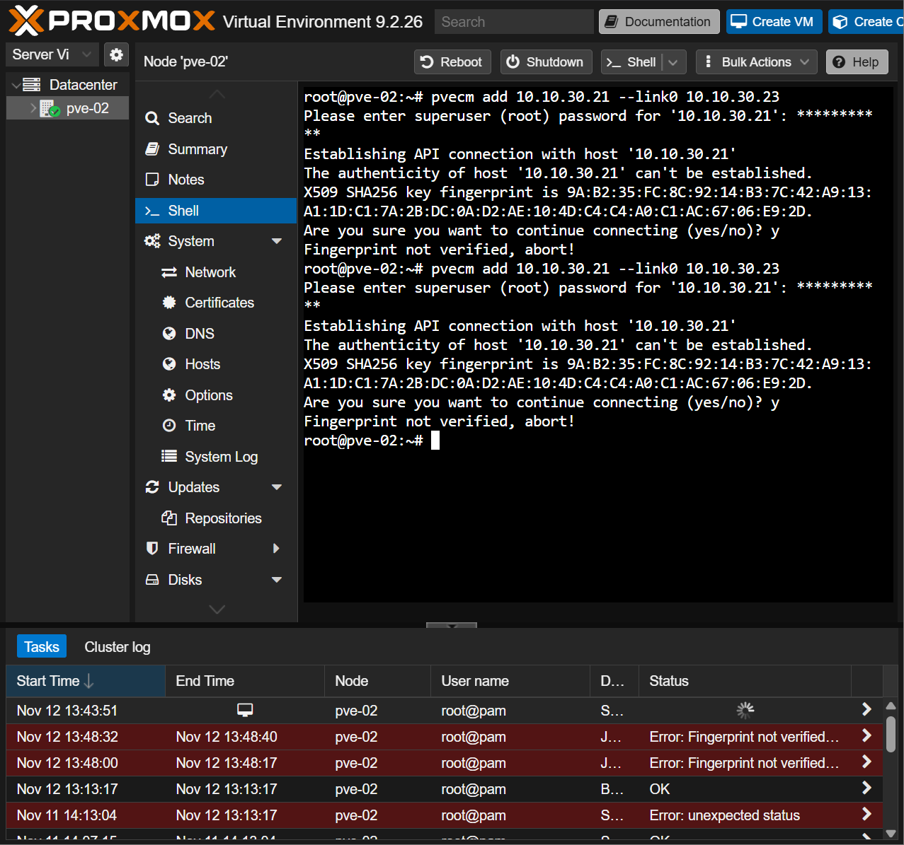

Proxmox affiche l'**empreinte** (*fingerprint*) SHA256 du certificat de pve-01 et demande `(yes/no)`. J'ai tapé `y`, qui n'est pas accepté : il faut écrire `yes` en entier. C'est une sécurité volontaire, pour qu'on ne valide pas une identité par réflexe. En entreprise, on compare cette empreinte avec celle affichée dans *pve-01 → System → Certificates* avant de répondre.

Avec `yes`, une autre erreur est apparue : **« 500 hostname verification failed »**. Le certificat de pve-01 a été créé à l'installation pour son adresse d'administration `10.10.10.21`, pas pour `10.10.30.21`. La connexion de contrôle (API, en HTTPS) doit donc viser `10.10.10.21`, tandis que `--link0` garde Corosync sur le VLAN 30 :

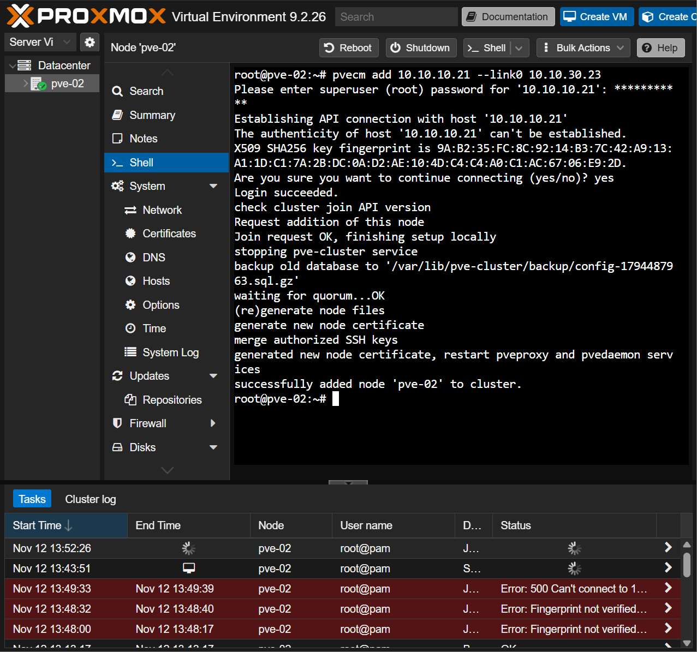

`pvecm add 10.10.10.21 --link0 10.10.30.23`, réponse `yes` : « Login succeeded », « waiting for quorum...OK », puis **« successfully added node 'pve-02' to cluster »**. L'API passe par le management, Corosync par le réseau cluster : c'est la bonne séparation.


L'arbre affiche maintenant **pve-01 et pve-02** sous le même Datacenter, tous deux en vert. Dans le journal, on retrouve les deux échecs (« Fingerprint not verified », « 500 Can't connect ») puis le « Join Cluster : OK ».

### 6.5 Ajout de l'arbitre et vérification du quorum

Depuis pve-01 : `pvecm qdevice setup 10.10.10.14`.


La sortie déroule toutes les étapes : l'arbitre **signe un certificat** pour le cluster (`cluster-CL-Lab.crt`), ce certificat est **importé sur pve-01 et pve-02** (« PKCS12 IMPORT SUCCESSFUL »), le QDevice est ajouté à la configuration, le service `corosync-qdevice` est démarré et activé sur les deux nœuds, puis `corosync.conf` est rechargé : **« Done »**.

La preuve demandée par le tableau de validation, `pvecm status` :


| Ligne | Valeur | Lecture |
|---|---|---|
| `Quorate` | Yes | Le cluster a la majorité et peut agir |
| `Expected votes` / `Total votes` | 3 / 3 | 2 nœuds + l'arbitre, tous présents |
| `Quorum` | 2 | Le minimum pour la majorité (2 sur 3) |
| `Flags` | Quorate Qdevice | Majorité atteinte, QDevice actif |
| Membres | `10.10.30.21`, `10.10.30.23`, `Qdevice` | Corosync passe bien par le VLAN 30 |
| `A,V,NMW` | — | **A**live (arbitre joignable), **V**ote (il vote), **NMW** = *Not Master Wins* (aucun nœud n'est prioritaire, c'est l'arbitre qui tranche) |

**Conséquence concrète :** si pve-02 tombe, pve-01 et l'arbitre gardent 2 voix sur 3, et le cluster continue. C'est ce qui rendra la tâche 4 (HA) possible.

Le QDevice n'utilise pas SSH (il a ses propres certificats, port 5403). J'ai donc refermé l'accès root :


La ligne redevient `#PermitRootLogin prohibit-password`. Le `#` en fait un commentaire, donc SSH reprend sa valeur par défaut : root ne peut plus se connecter par mot de passe. L'étoile `*` dans la barre de nano signale que le fichier n'est pas encore enregistré (Ctrl+O).


Fichier enregistré, puis `systemctl restart ssh` revient au prompt sans message : le service a rechargé sa configuration. Pour contrôler la valeur réellement appliquée, on peut taper `sshd -T | grep permitrootlogin`.

### 6.6 Le réseau des migrations

Dernier réglage de la tâche : *Datacenter → Options → Migration Settings*. Lors d'une migration à chaud, toute la RAM de la VM traverse le réseau. On l'envoie sur le réseau cluster pour ne pas saturer l'administration.


`network=10.10.30.0/24,type=secure` : les migrations passent par le VLAN 30, dans un tunnel SSH chiffré (`secure`). La liste déroulante proposait l'adresse de pve-01 (`10.10.30.21/24`) et l'enregistrait telle quelle ; j'ai tapé le réseau à la main (voir *Problèmes rencontrés*).

**La notation CIDR `/24`.** Une adresse IPv4 fait 32 bits (4 nombres de 8 bits). `/24` signifie que les 24 premiers bits (les 3 premiers nombres) désignent le **réseau** et les 8 derniers la **machine**. `10.10.30.0/24` couvre donc `10.10.30.1` à `10.10.30.254` ; `.0` désigne le réseau lui-même et `.255` le broadcast. Équivalent en masque : `255.255.255.0`. Deux machines du même `/24` se parlent directement ; sinon, elles passent par la passerelle. **La tâche 2 est terminée.**

---

## 7. Tâche 3 — Stockage partagé NFS

### 7.1 Pourquoi un stockage partagé

Jusqu'ici, chaque nœud n'a que ses disques locaux (`local`, `local-lvm`). Une VM créée sur pve-01 aurait son disque **dans** pve-01 : si pve-01 tombe, son disque devient inaccessible. Avec un stockage **partagé**, le disque de la VM vit sur nas-01 et les deux nœuds le voient en même temps :

- **migration à chaud** (tâche 6) : seule la RAM voyage, le disque ne bouge pas ;
- **HA** (tâche 4) : le nœud survivant redémarre la VM directement depuis le même disque.

**À ne pas confondre :** **NFS** (*Network File System*) est un **protocole réseau** de partage de dossiers. **ext4** (Linux) et **NTFS** (Windows) sont des **systèmes de fichiers**, c'est-à-dire la façon d'organiser les données sur un disque. Sur nas-01, les disques sont en ext4 et partagés en NFS. L'équivalent Windows de NFS est **SMB** (`\\serveur\partage`). *ds01* signifie *datastore 01*, le vocabulaire de VMware repris par l'énoncé.

### 7.2 Déclaration des deux stockages

*Datacenter → Storage → Add → NFS*. On le fait au niveau Datacenter pour que le stockage soit déclaré une seule fois pour tout le cluster.


ID `NFS-ds01`, serveur `10.10.10.50`, contenu **Disk image** et **ISO image**, nœuds **All**. L'export `/srv/nfs/ds01` a été **choisi dans la liste** : Proxmox a interrogé nas-01, qui lui a renvoyé ses partages. Cela prouve en même temps que le réseau et le fichier `/etc/exports` sont corrects.

`NFS-ds02` a été déclaré de la même façon avec l'export `/srv/nfs/ds02`. Attention : la fenêtre pré-remplissait l'export `/srv/nfs/ds01`. Sans relecture, les deux stockages auraient pointé vers le même disque (voir *Problèmes rencontrés*).

### 7.3 Vérification sur les deux nœuds

Un stockage est déclaré au niveau Datacenter, mais c'est **chaque nœud** qui se connecte lui-même au NAS. On vérifie donc là où la configuration s'applique :


Sous **pve-01** comme sous **pve-02**, les deux stockages NFS apparaissent sans point d'interrogation ni croix rouge. Le détail de NFS-ds01 sur pve-01 indique **Enabled : Yes** (activé dans la configuration) et **Active : Yes** (réellement joignable), et **0 B of 20.96 GB** : c'est bien le disque de 20 Go de nas-01, encore vide. Dans la liste Storage, la colonne **Shared** vaut **Yes** pour les deux NFS, contre « No » pour `local` et `local-lvm`. **La tâche 3 est terminée.**

**Limite à garder en tête :** la HA protège les nœuds, mais nas-01 reste un **SPOF** (*Single Point Of Failure*, point unique de défaillance). S'il tombe, les deux nœuds perdent les disques. En entreprise, la baie de stockage est elle-même redondante (deux contrôleurs, alimentations doublées, RAID).

---

## 8. Préparation de la tâche 5 — Le réseau des VM (`vmbr2`)

La VM Debian de la tâche 5 doit être dans le **VLAN 20** (`10.10.20.0/24`). L'énoncé indique « bridge vmbr0 VLAN 20 », parce que sur de vrais serveurs, plusieurs VLAN passent par le même câble avec une étiquette (*tag*). Dans ce labo, chaque VLAN est un réseau VMware séparé et arrive sur sa propre carte : j'ai donc créé un **bridge dédié**, `vmbr2`, sur la carte `nic2` (VMnet2).


Nom `vmbr2`, port `nic2`, Autostart coché, VLAN aware décoché, commentaire « VM (VLAN 20) ». **Aucune adresse IP** : le nœud ne fait que relier les VM à ce réseau, il n'a pas besoin d'y parler lui-même. Moins d'adresses sur l'hyperviseur, c'est aussi moins de points d'entrée.


Configuration identique sur pve-02 (on reconnaît d'autres adresses MAC dans *Alternative Names*). Le nom doit être **le même** sur les deux nœuds : lors d'une migration, la VM cherche un bridge `vmbr2` sur le nœud d'arrivée.

Une modification réseau n'est pas appliquée tout de suite. Proxmox affiche d'abord un panneau **Pending changes**, sous forme de *diff* de `/etc/network/interfaces` : les lignes préfixées par `+` (`auto vmbr2`, `iface vmbr2 inet manual`, `bridge-ports nic2`) seront ajoutées. `inet manual` signifie « sans adresse IP ». Il faut ensuite cliquer sur **Apply Configuration**.


Après Apply, `vmbr2` et `nic2` sont **Active : Yes**, le panneau Pending changes a disparu, et le journal montre « SRV networking - Reload : OK » sur pve-01 et pve-02.

---

## 9. Tâche 5 — Machine virtuelle vm-deb-pve-01

**Ce qu'on construit :** la VM « cliente » qui servira de cobaye à toutes les tâches suivantes (migration, déplacement de disque, HA, snapshots). Cahier des charges : Debian 12, 1 vCPU, 2 Go de RAM, disque de 20 Go sur **NFS-ds01**, réseau VLAN 20, IP fixe, agent QEMU.

### 9.1 Une image cloud plutôt qu'une installation

Installer Debian à la main dans une VM en **émulation** aurait pris plus d'une heure. J'ai utilisé une **image cloud** officielle : un Debian **déjà installé**, prêt à démarrer, que Debian publie pour les clouds et les hyperviseurs. Sa configuration (nom, utilisateur, mot de passe, IP) est appliquée au premier démarrage par **cloud-init**, un programme qui lit un petit CD virtuel préparé par Proxmox. C'est la méthode utilisée en entreprise pour créer des VM en série (AWS, Infomaniak, clusters Proxmox).

Le téléchargement se fait sans ligne de commande : *pve-01 → stockage `local` → Import → Download from URL*, avec l'adresse officielle `https://cloud.debian.org/images/cloud/bookworm/latest/debian-12-genericcloud-amd64.qcow2`.


Debian a d'abord répondu `302 Found` : il a redirigé le téléchargement vers un **miroir** (une copie officielle, ici en Suède). Ensuite viennent `200 OK`, 333 Mo enregistrés dans `/var/lib/vz/import/` en un peu plus d'une minute, et `TASK OK`. `bookworm` est le nom de code de Debian 12. `genericcloud` est la version allégée pour machines virtuelles. `.qcow2` est le format de disque de QEMU.

### 9.2 La passerelle du VLAN 20

L'énoncé demande que la VM pingue sa passerelle `10.10.20.1` (tâche 6). Dans ce labo, cette adresse est celle du **PC hôte** sur le réseau VMnet2. Je l'ai vérifiée avec `ipconfig` :


La carte « VMware Network Adapter VMnet2 » a bien l'adresse `10.10.20.1` et le masque `255.255.255.0`, ce qui correspond au `/24`. Elle n'a **pas de passerelle par défaut** : ce réseau est isolé et ne mène pas à Internet.

### 9.3 Création de la VM, puis import du disque

J'ai d'abord créé la « coque » de la VM avec l'assistant **Create VM** : *Do not use any media* (pas de CD d'installation), *Qemu Agent* coché, 1 socket × 1 cœur, 2048 Mo, carte **VirtIO** sur `vmbr2`. J'ai **supprimé** le disque proposé, puisque celui de l'image cloud allait être importé.


Le résumé correspond exactement au fichier de configuration que Proxmox va écrire : `agent 1`, `cores 1`, `memory 2048`, `net0 virtio,bridge=vmbr2` et **aucune ligne `scsi0`**. **VirtIO** est une carte réseau « paravirtualisée » : la VM sait qu'elle est virtuelle et échange directement avec l'hyperviseur, ce qui est bien plus rapide que l'émulation d'une vraie carte.

Comme les nœuds sont eux-mêmes des VM sans VT-x (voir 2.2), il faut désactiver l'accélération KVM, sinon la VM refuse de démarrer (*Options → KVM hardware virtualization*) :


**KVM hardware virtualization : No** et **QEMU Guest Agent : Enabled**. On voit aussi que l'ordre de démarrage vaut encore `ide2, net0`. La VM n'a pas encore de disque, il faudra donc corriger cet ordre après l'import.

L'import se fait dans le Shell de pve-01 :

```bash
qm disk import 100 /var/lib/vz/import/debian-12-genericcloud-amd64.qcow2 NFS-ds01 --format qcow2
```

`qm` est l'outil Proxmox de gestion des VM. `disk import 100` copie un disque existant dans la VM 100, et `NFS-ds01` est le stockage de destination sur le NAS. `--format qcow2` est **indispensable** : sur un stockage NFS, seuls les disques qcow2 permettent les **snapshots** (tâche 9). Le qcow2 est aussi **dynamique** (*thin provisioning*) : il n'occupe sur le NAS que la place réellement écrite.


Le disque fait 3 Go. La dernière ligne `unused0: successfully imported disk 'NFS-ds01:100/vm-100-disk-0.qcow2'` indique qu'il est sur le NAS, mais pas encore branché (« unused »).

### 9.4 Branchement, agrandissement et configuration cloud-init

Dans *Hardware*, j'ai fait plusieurs opérations :

- j'ai branché le disque (*Unused Disk 0 → Add*, il devient `scsi0`) ;
- je l'ai agrandi de 17 Go (*Disk Action → Resize*) : 3 + 17 = **20 Go**. Cloud-init étend la partition tout seul au premier démarrage ;
- j'ai ajouté un **CloudInit Drive** sur NFS-ds01 ;
- j'ai ajouté une **2ᵉ carte réseau temporaire** `net1` sur `vmbr0`. Le VLAN 20 est isolé, et sans elle, la VM n'aurait pas pu télécharger l'agent QEMU.

Enfin, dans *Options → Boot Order*, `scsi0` a été placé en première position.


On y lit : 2 Gio de RAM, `Hard Disk (scsi0) NFS-ds01:100/vm-100-disk-0.qcow2,…,size=20G`, `CloudInit Drive (ide0)` sur NFS-ds01, `net0` sur `vmbr2` et `net1` sur `vmbr0`. Le type de processeur vaut encore `x86-64-v2-AES` (voir 9.5).


Cloud-init est configuré ainsi :

- utilisateur `lami`, avec un mot de passe masqué ;
- DNS repris de l'hôte ;
- `net0` en `10.10.20.31/24` **sans passerelle**. Sinon la VM chercherait Internet via le PC, qui ne route pas ce réseau. Le ping vers `10.10.20.1` fonctionne quand même, puisque c'est le même réseau ;
- `net1` en DHCP.

Sur la capture, **Upgrade packages** vaut encore « Yes ». Je l'ai passé à **No** avant le démarrage : en émulation, installer toutes les mises à jour au premier boot aurait pris plus de 30 minutes. C'est un choix de délai, pas une bonne pratique. En entreprise, une VM doit démarrer à jour. Ici, `apt update` a d'ailleurs ensuite affiché « All packages are up to date ».

### 9.5 Premier démarrage : kernel panic, puis succès

Le premier démarrage s'est arrêté net au bout de 6 secondes :


`end Kernel panic - not syncing: Attempted to kill init!` : le **noyau** Linux s'est arrêté parce que **init** (systemd, le tout premier programme lancé) a planté. C'est l'équivalent de l'« écran bleu » de Windows. **Cause retenue :** le processeur virtuel `x86-64-v2-AES` annonce des instructions avancées (AES, SSE4.2…) que l'**émulateur** (TCG) gère mal. Avec KVM, c'est le vrai processeur qui les exécute. **Correction :** VM arrêtée avec *Stop* (le système était figé, un *Shutdown* propre ne pouvait pas répondre), puis type de processeur passé à **`qemu64`**, le modèle de base que l'émulateur gère parfaitement.


`Debian GNU/Linux 12 vm-deb-pve-01 tty1` puis `login:`. Le nom `vm-deb-pve-01` n'est pas dans l'image d'origine : c'est **cloud-init** qui l'a appliqué, ce qui prouve qu'il a bien lu la configuration de Proxmox.

### 9.6 Réseau et agent QEMU


`eth0` (nom alternatif `ens18`) a l'adresse **`10.10.20.31/24`**. C'est bien `net0` : son adresse **MAC** `bc:24:11:c1:42:35` est identique à celle affichée dans *Hardware*, et la MAC est le moyen fiable de reconnaître une carte. `eth1` (`ens19`) a reçu `10.10.10.134/24` du DHCP de VMware (mot-clé `dynamic`, avec une durée de bail `valid_lft`).

L'**agent QEMU** est un petit service installé **dans** la VM qui dialogue avec Proxmox. Il permet de remonter l'IP, de faire un arrêt propre et de figer le disque pendant un snapshot ou une sauvegarde. C'est l'équivalent des *VMware Tools*.

```bash
sudo apt update
sudo apt install qemu-guest-agent
sudo systemctl start qemu-guest-agent
```


La première tentative a échoué avec `E: Unable to locate package` : le nom du paquet était mal tapé. Les noms de paquets doivent être exacts. La deuxième installe `qemu-guest-agent`. Le message `is a disabled or a static unit, not starting it` n'est pas une erreur : ce service démarre normalement quand Linux détecte le canal de communication avec Proxmox, d'où le `systemctl start` manuel, qui ne renvoie rien (une commande Linux qui réussit est silencieuse).


Dans *Summary*, la case **IPs** affiche `10.10.20.31` : Proxmox connaît l'adresse de la VM sans la demander au réseau, c'est l'agent qui la lui transmet. On lit aussi **Bootdisk size : 20.00 GiB** (le redimensionnement a fonctionné), environ 475 Mio de RAM utilisés sur 2 Gio, et **HA State : none** (la VM n'est pas encore protégée).

L'agent installé, la carte temporaire `net1` a été **retirée à chaud** (*Hardware → Remove*) : la VM n'est plus que sur le VLAN 20. C'est le **principe du moindre privilège**, qui consiste à ne laisser que les accès nécessaires. **La VM Debian de la tâche 5 est terminée.**

**VM Windows Server (non réalisée).** En émulation, sans accélération matérielle, l'installation de Windows Server 2022 et des pilotes VirtIO aurait pris plusieurs heures pour une seule VM. J'ai préféré utiliser ce temps pour réaliser les tâches de migration, de HA et de permissions sur la VM Debian. Le bonus de la tâche 6 (« With local disks » sur la VM Windows) n'a donc pas été fait non plus.

---

## 10. Tâche 6 — Migration à chaud

**Ce qu'on teste :** déplacer la VM **allumée** d'un nœud à l'autre. Comme son disque est sur le NAS, seule sa **mémoire vive** voyage, par le VLAN 30. C'est l'équivalent du **vMotion** de VMware. Pour mesurer l'impact, un `ping 10.10.20.1` tourne en continu dans la VM pendant toute la migration.

*Clic droit sur la VM → Migrate → Target node : pve-02 → Mode : Online*


Le journal montre chaque étape :

- `use dedicated network address … (10.10.30.23)` : la migration passe bien par le réseau dédié réglé à la tâche 2 ;
- `start remote tunnel` / `ssh tunnel` : le transfert est chiffré, c'est le mode *secure* ;
- `migration downtime limit: 100 ms` : Proxmox s'engage à ne pas geler la VM plus longtemps que ça ;
- `transferred 537.9 MiB VM-state` : seule la RAM utilisée a voyagé, le disque n'a pas bougé ;
- **`downtime 45 ms`** et `migration finished successfully (duration 00:00:09)`.

**Principe :** Proxmox copie la RAM pendant que la VM tourne, puis recopie les pages modifiées entre-temps, jusqu'à ce qu'il en reste très peu. Il gèle alors la VM une fraction de seconde, envoie le reste et la relance sur l'autre nœud.


`194 packets transmitted, 194 received, 0% packet loss` : **aucun paquet perdu**, alors que l'énoncé en tolérait un. Le temps d'aller-retour maximal (`rtt max`) est de 5,9 ms, contre environ 2 ms d'habitude. `ttl=128` est la valeur de départ typique de Windows : c'est bien le PC hôte qui répond. La VM tourne maintenant sur **pve-02**.


Au retour : `downtime 38 ms` et `duration 00:00:16`. La vitesse moyenne n'a été que de 229 Mio/s, contre 1 Gio/s à l'aller, parce que tout le labo partage le même processeur et la même charge.


`57 packets transmitted, 57 received, 0% packet loss` : là encore, aucune perte.

| Sens | Durée totale | Gel de la VM | RAM transférée | Paquets perdus |
|---|---|---|---|---|
| pve-01 → pve-02 | 9 s | 45 ms | 537,9 Mio | 0 / 194 |
| pve-02 → pve-01 | 16 s | 38 ms | 537,9 Mio | 0 / 57 |

**En entreprise**, c'est ce qui permet de faire la maintenance d'un serveur en pleine journée : on déplace ses VM vers un autre nœud, on le met à jour, on le redémarre, puis on les ramène, sans coupure de service. **La tâche 6 est terminée** (sans le bonus Windows, voir 9.6).

---

## 11. Tâche 7 — Déplacement de disque à chaud

**Ce qu'on teste :** cette fois, la VM reste sur pve-01 et c'est son **disque** qui déménage, de NFS-ds01 vers NFS-ds02, VM allumée. C'est l'équivalent du **Storage vMotion**. En entreprise, on s'en sert pour vider un stockage plein, remplacer une baie en fin de vie ou placer une VM sur un stockage plus rapide.

*Hardware → Hard Disk (scsi0) → Disk Action → Move Storage → NFS-ds02, format qcow2, Delete source coché*


`mirror-scsi0: transferred 20.0 GiB of 20.0 GiB (100.00%) in 20m 56s, ready` : Proxmox utilise un **miroir**. Il copie le disque pendant que la VM tourne et écrit chaque nouvelle donnée sur **les deux** disques à la fois. Une fois les deux copies identiques (`ready`), il bascule la VM sur le nouveau disque (`Completed successfully`). La ligne `removing source volume 'NFS-ds01:100/vm-100-disk-0.qcow2' after successful copy` correspond à l'option *Delete source* : l'original n'est supprimé **qu'après** la réussite de la copie. La tâche a duré de 14:07:02 à 14:28:01 (horloge du nœud), soit **environ 21 minutes**.

La durée s'explique ainsi : on copie le disque **entier** (20 Go, zones vides comprises), et pas seulement la RAM utilisée comme pour une migration. De plus, les données font l'aller-retour nas-01 → pve-01 → nas-01 sur le même SSD de PC portable, avec un processeur partagé par tout le labo.


La configuration de la VM indique maintenant `Hard Disk (scsi0) NFS-ds02:100/vm-100-disk-0.qcow2,…,size=20G`. On voit aussi le processeur `qemu64` et la disparition de `net1`. Seul le petit lecteur cloud-init est resté sur NFS-ds01.


`1724 packets transmitted, 1724 received, 0% packet loss` sur environ 29 minutes : aucune coupure. Mais le temps de réponse maximal monte à **459,8 ms**, contre environ 2 ms d'habitude. C'est **l'impact** du déplacement : pas de coupure, mais un **ralentissement** pendant la copie. En entreprise, on lance donc ce type d'opération en dehors des heures de pointe.

### 11.1 Effet de bord : pve-02 vu « hors ligne »

Pendant le déplacement, en créant l'utilisateur de la tâche 10, l'interface a affiché une erreur et pve-02 est passé au rouge :


On lit `Connection error - server offline?` et une **croix rouge** sur pve-02 dans l'arbre. Les comptes sont stockés dans la configuration **partagée** du cluster : tant qu'il y a un doute sur un membre, Proxmox ne valide pas l'écriture.

Avant d'agir, j'ai vérifié l'état réel de pve-02, directement depuis sa console :


La commande `uptime` affiche une charge (*load average*) de 2,95, sous les 4 vCPU de pve-02 : le nœud n'est pas débordé. `pvecm status` indique **Quorate : Yes**, 3 votes, avec les deux nœuds et le Qdevice. L'indice est le **Ring ID `1.1ea`**, qui valait `1.9` la veille. Ce compteur augmente à chaque réorganisation du cluster : `1ea` en hexadécimal, c'est 490. Le cluster avait donc « perdu » puis retrouvé des membres des centaines de fois.

**Conclusion :** le déplacement de disque saturait les entrées/sorties du SSD, partagé par toutes les VM. Les messages Corosync (« je suis vivant ») arrivaient parfois en retard, et le lien « clignotait » (*flapping*). pve-02 est revenu au vert dès la fin du déplacement (14:28), sans aucune intervention. C'est exactement pour éviter ce problème qu'en entreprise, Corosync dispose d'un **réseau dédié et peu chargé**. C'est le cas ici avec le VLAN 30, mais tout le labo partage le même PC.

**Retour sur NFS-ds01 (non réalisé).** Il aurait pris encore une vingtaine de minutes, avec le même risque de perturber le cluster. Faute de temps, je l'ai laissé de côté : la durée de l'aller (21 min) et son impact sont documentés ci-dessus. Le disque restant sur NFS-ds02, ce déplacement sert aussi d'action de la tâche 8 (« déplacer vers NFS-ds02 »). **La tâche 7 est terminée, sans le retour.**

---

## 12. Tâche 10 — Permissions et accès

**Ce qu'on construit :** un compte **auditeur** qui peut **tout voir mais rien modifier**. C'est le compte qu'on donne à un stagiaire, à un auditeur de sécurité ou à un outil de supervision, selon le **principe du moindre privilège** : chacun n'a que les droits nécessaires.

*Datacenter → Permissions → Users → Add*


Le premier essai a été refusé avec `value 'auditeur @pve' does not look like a valid user name`. Un **espace** s'était glissé après « auditeur ». Dans un identifiant, l'espace est lu comme un séparateur : règle générale en informatique, pas d'espace ni d'accent dans les identifiants.


L'utilisateur `auditeur` apparaît avec le **realm** `pve`, à côté de `root` (realm `pam`). Un *realm* est l'annuaire où le compte est rangé. **PAM** contient les comptes système Linux de chaque nœud. **Proxmox VE authentication server** (`@pve`) contient les comptes propres à Proxmox, partagés par tout le cluster : c'est le bon choix pour un compte applicatif.

*Datacenter → Permissions → Add → User Permission*


La fenêtre est remplie ainsi :

- **Path `/`** : la racine, c'est-à-dire tout le cluster (nœuds, VM, stockages) ;
- **User** : `auditeur@pve` ;
- **Role** : **`PVEAuditor`**. Un rôle est un ensemble de droits prédéfini. PVEAuditor ne contient que des droits de **lecture** ;
- **Propagate** coché : le droit se transmet à tout ce qui se trouve sous `/`.


La règle d'accès (ACL) est enregistrée : `/` → `auditeur@pve` → `PVEAuditor` → propagation `true`.

**Test :** connexion avec ce compte dans une fenêtre de navigation privée, pour garder la session root ouverte dans l'autre fenêtre.


En haut à droite, on lit **auditeur@pve**. L'auditeur voit tout l'inventaire et le détail de la VM (état, nœud, IP, graphiques), mais les boutons **Start, Shutdown et Migrate sont grisés**. Son menu est aussi **réduit** : Backup, Replication et Permissions n'apparaissent plus. Proxmox n'affiche même pas ce que l'utilisateur n'a pas le droit d'utiliser. **La tâche 10 est terminée.**

---

## 13. Tâche 4 — Haute disponibilité (HA)

*La tâche 4 a été réalisée après les tâches 5 à 7, parce qu'il faut une VM pour tester la HA.*

**Ce qu'on construit :** on déclare au cluster que la VM doit **toujours** tourner. Si son nœud tombe, le cluster la **redémarre automatiquement** sur l'autre nœud. Ce n'est pas de la continuité parfaite : la VM s'éteint brutalement avec son nœud, puis elle redémarre. Ce n'est pas non plus une sauvegarde, car une erreur dans la VM est redémarrée avec elle.

### 13.1 Confier la VM à la HA

*Datacenter → HA → Resources → Add → VM 100, Requested State : started*


| Ligne | Signification |
|---|---|
| **quorum : OK** | Le cluster a la majorité : la HA a le droit d'agir. |
| **fencing : armed** | La « clôture » est armée. Chaque nœud doit régulièrement « nourrir » un **watchdog** (minuteur). Un nœud qui perd le contact avec le cluster ne peut plus le faire et **se redémarre tout seul**. On garantit ainsi qu'une VM ne tourne **jamais en double**, ce qui détruirait son disque. |
| **master : pve-02** | Le **CRM** (*Cluster Resource Manager*), le « chef d'orchestre » de la HA, tourne sur pve-02. |
| **lrm : pve-01 active / pve-02 idle** | Le **LRM** (*Local Resource Manager*) est l'exécutant de chaque nœud. Il est actif là où tourne une VM protégée. |
| **vm:100 – starting** | La VM vient d'être prise en charge. Elle passe ensuite à `started`. |

### 13.2 La règle « HA-Lab »

L'énoncé demande un **groupe HA** « HA-Lab ». Depuis **Proxmox VE 9**, les groupes HA ont été remplacés par des **règles d'affinité** (*HA → Affinity Rules*). Le principe est le même : indiquer sur quels nœuds la ressource a le droit de tourner, et avec quelle priorité.


La règle est configurée ainsi :

- type **Node Affinity**, avec la ressource `100` ;
- affinité **Prefer Nodes (positive)** ;
- **pve-01 et pve-02 cochés**, avec la même priorité (champ vide). Aucun nœud n'est préféré, ce qui correspond à la « priorité égale » de l'énoncé ;
- **Strict décoché** : si aucun nœud de la liste n'est disponible, la VM peut aller ailleurs.

Proxmox 9 ne demande pas de nom pour la règle : j'ai mis `HA-Lab` en commentaire.


Dans la liste, la règle apparaît **activée**, avec l'affinité `positive`, `Strict false`, la ressource `vm:100`, les nœuds `pve-01,pve-02` et le commentaire **HA-Lab**.

### 13.3 Test de panne : coupure brutale de pve-02

On place d'abord la VM sur pve-02. Comme elle est gérée par la HA, la migration passe par le gestionnaire :


La tâche « HA 100 - Migrate » se contente de **déposer une demande** (`Requesting HA migration for VM 100 to node pve-02`, `TASK OK`). C'est le gestionnaire HA qui lance ensuite la vraie migration (« VM 100 - Migrate », toujours en cours en bas). Pendant ce temps, un **cadenas (migrate)** verrouille la VM. On ne pilote plus la VM directement : on **déclare l'état voulu**, et c'est le gestionnaire qui l'exécute.


Avant la panne, on lit **Node : pve-02**, **HA State : started** et **Status : running**. La migration a duré 7 secondes. L'uptime de 1 min 18 s correspond au processus de la VM sur pve-02 : Debian n'a pas redémarré.

pve-02 a ensuite été coupé **brutalement** dans VMware (*Alimentation → Mettre hors tension*), pour simuler une vraie panne (alimentation grillée, câble arraché) et non un arrêt propre.


Juste après la coupure, la situation est la suivante :

- pve-02 porte une **croix rouge** ;
- **quorum : OK** : pve-01 et l'arbitre font 2 voix sur 3, le cluster garde le droit d'agir. **C'est le QDevice qui rend la HA possible avec deux nœuds** : sans lui, pve-01 serait seul (1 voix sur 2) et se bloquerait ;
- **master : pve-02 (old timestamp - dead?)** : le chef d'orchestre tournait justement sur le nœud coupé. C'est le **pire cas**, puisque le cluster doit d'abord élire un nouveau chef avant de sauver la VM ;
- **fencing : standby**, et vm:100 est encore affichée sur pve-02.

Les états intermédiaires `fence` puis `recovery` n'ont duré que quelques secondes : ils sont passés entre deux rafraîchissements de la page et n'ont pas été capturés. Ils restent consultables dans le journal du gestionnaire HA avec `journalctl -u pve-ha-crm | grep vm:100`. La capture suivante montre l'état final, quelques minutes plus tard.


Le résultat, sans aucune intervention :

- **master : pve-01 (active)** : un nouveau chef a été élu ;
- **fencing : armed** ;
- **vm:100 – started – pve-01**, et la VM apparaît sous pve-01 dans l'arbre ;
- les stockages de pve-02 affichent un `?`, ce qui est normal puisqu'il est éteint ;
- en bas, la tâche **« VM 100 - Start » sur pve-01 à 14:53:38** est celle de la HA.

Les états intermédiaires `fence` puis `recovery` n'ont duré que quelques secondes : ils sont passés entre deux rafraîchissements de la page.

**Délai mesuré :** le dernier signe de vie du LRM de pve-02 date de **14:50:27**, et la VM a redémarré sur pve-01 à **14:53:38**, soit **environ 3 min 10 s**. C'est dans la fourchette de 2 à 5 minutes de l'énoncé. Ce délai est **voulu** : le cluster attend que le watchdog de pve-02 ait forcément expiré avant de démarrer la VM ailleurs. Si pve-02 n'était que **déconnecté** du réseau, démarrer la VM tout de suite reviendrait à la faire tourner en double sur le même disque.

*Remarque :* les heures affichées viennent des horloges des nœuds, qui retardaient d'environ 10 minutes sur celle du PC (constaté avec `uptime` sur pve-02). Les **durées** restent exactes, puisque les deux heures viennent de la même horloge. En production, tous les serveurs se synchronisent sur la même source d'heure (**NTP**).

pve-02 a ensuite été rallumé. La VM est restée sur pve-01 : les deux nœuds ont la même priorité, rien ne justifie de la déplacer. **La tâche 4 est terminée.**

---

## 14. Tâche 9 — Snapshots, clones et template

**Ce qu'on construit :** trois façons de « copier » une VM, chacune avec un usage différent. Un **snapshot** est une photo de la VM à un instant donné, vers laquelle on peut revenir. Un **clone** est une nouvelle VM fabriquée à partir d'une autre. Un **template** est une VM figée qui sert de modèle.

### 14.1 Avant de commencer : le NAS tombe en panne

La première tentative de snapshot a été refusée :


Le message est `TASK ERROR: storage 'NFS-ds02' is not online`, et dans l'arbre, les deux stockages NFS portent un `?` gris, même sous pve-01. Avant toute action, Proxmox vérifie que le stockage répond. Ici le NAS ne répondait plus, donc il a refusé par sécurité.

La console de nas-01 a donné la cause :


L'écran est rempli de lignes `e1000 0000:02:01.0 ens33: Detected Tx Unit Hang` qui reviennent toutes les deux secondes. **e1000** est le modèle de carte réseau virtuelle donné par VMware à nas-01 : il imite une ancienne carte Intel. **Tx Unit Hang** signifie que son circuit d'**envoi** (*Tx*, transmission) est bloqué. Le NAS est vivant, mais il ne peut plus rien envoyer sur le réseau. C'est un problème connu de la carte e1000 de VMware sous fort trafic, et c'est exactement ce que lui ont fait subir le *Move disk* et les migrations des tâches précédentes. Le flot de messages empêchait même de taper une commande.

La vérification côté Proxmox, avec `pvesm status` (l'outil qui liste les stockages et leur état) :


`NFS-ds01` et `NFS-ds02` sont **inactive**, alors que `local` et `local-lvm` (les disques internes du nœud) restent **active**. Seul le NAS est en cause.

**Correction :** nas-01 a été réinitialisé dans VMware (*Alimentation → Réinitialiser*). Ses données ne risquaient rien : les partages utilisent l'option `sync`, qui oblige chaque écriture à être enregistrée sur le disque avant d'être confirmée. Au redémarrage, le partage NFS est revenu tout seul, grâce au `fstab` et à `/etc/exports`. Pendant la panne, la VM 100 est restée **figée** au lieu de planter : un client NFS **attend** son serveur. **En entreprise**, on donnerait au NAS une carte **vmxnet3**, la carte paravirtualisée de VMware (l'équivalent du VirtIO de Proxmox), qui n'a pas ce défaut. Pour la suite du TP, on a évité les grosses copies par le réseau.

### 14.2 Snapshot « Etat-initial »

*VM 100 → Snapshots → Take Snapshot → Name : Etat-initial, Include RAM décoché*


Le journal se lit en quatre lignes :

- `freeze guest filesystem` : grâce à l'**agent QEMU** installé à la tâche 5, Proxmox demande à Debian de **figer** ses écritures une fraction de seconde. Le disque est ainsi photographié dans un état propre, sans fichier à moitié écrit ;
- `snapshotting 'drive-scsi0' (NFS-ds02:100/vm-100-disk-0.qcow2)` puis `internal qemu snapshot` : la photo est rangée **à l'intérieur du fichier qcow2**. C'est pour cela que le format qcow2 a été choisi à l'import : sur un stockage NFS, un disque *raw* ne permettrait pas de snapshot ;
- `thaw guest filesystem` : *thaw* veut dire « dégeler », Debian reprend ses écritures ;
- `TASK OK`.

Sans l'agent, on photographierait un disque en pleine écriture, et on risquerait de restaurer un système de fichiers incohérent.

### 14.3 Modification, puis retour arrière

Pour prouver le retour arrière, on modifie la VM en créant un fichier :


Après connexion avec le compte `lami`, la commande `echo > fichier-test.txt` crée un fichier, et `ls` affiche bien `fichier-test.txt`. Une première tentative avec `root` avait échoué (« Login incorrect ») : les images cloud de Debian **verrouillent le compte root**. On se connecte avec le compte créé par cloud-init et on passe par `sudo` pour l'administration. C'est la bonne pratique en entreprise, car les journaux montrent alors **qui** a fait quoi.


La liste montre le snapshot **Etat-initial** (15:11:46, RAM : No) et, en dessous, **NOW – « You are here! »**, l'état actuel qui découle du snapshot. L'avertissement « *Current state will be lost* » rappelle qu'un retour arrière (*rollback*) est **irréversible** : tout ce qui a été fait depuis la photo est jeté.

**Ce qui s'est passé ensuite, honnêtement :** après le rollback, la VM est restée bloquée au démarrage, au moment où *systemd* lance les services. C'est très probablement une conséquence de la panne du NAS qui venait d'avoir lieu. Un *Reboot* a ensuite échoué (`QEMU Guest Agent is not running`, puis `VM quit/powerdown failed - got timeout`), et un *Stop* lancé en même temps a été refusé (`can't lock file '/var/lock…'`), car la VM était **verrouillée** par le reboot en cours. Deux actions sur la même VM au même moment se bloquent mutuellement. La demande d'arrêt passée par la HA (« HA 100 - Stop ») a fini par s'appliquer, et la VM s'est arrêtée proprement (`Status : stopped`, `HA State : stopped`). La preuve du retour arrière est donc la tâche **Rollback** terminée avec succès. Le `ls` final qui aurait montré la disparition du fichier n'a pas pu être fait.

### 14.4 Clone complet : vm-deb-pve-02

La VM 100 étant arrêtée, on la clone :


La fenêtre ne propose **pas** de choix « Full / Linked » : depuis une VM normale, le clone est **toujours complet**. Le clone lié n'est possible qu'à partir d'un template (voir 14.5). La cible est l'ID **101**, le nom **vm-deb-pve-02**, le stockage **NFS-ds01** (pour répartir les VM entre les deux stockages) et le format **qcow2**.


Le clone a réussi en **24 secondes** (15:29:05 → 15:29:29). Juste en dessous, on voit la première tentative de 15:26, échouée pendant la panne du NAS (`clone failed: storage…`). La VM étant éteinte, Proxmox ne copie que les **données réellement écrites** (environ 1,5 Go) et saute les zones vides du disque de 20 Go. À comparer avec les **21 minutes** du déplacement à chaud de la tâche 7, qui a dû parcourir les 20 Go.

### 14.5 Template et clone lié : vm-deb-lie

La VM 101 a été convertie en template (*clic droit → Convert to template*), puis clonée :


Le titre est désormais « **Clone VM Template 101** », la ligne **Mode** est apparue avec **Linked Clone**, et le **stockage cible est grisé** (« Same as source »). C'est logique : un clone lié s'appuie sur le disque du template, il doit donc être sur **le même stockage**.


L'arbre contient maintenant **100** (la VM d'origine), **101** avec l'icône de template, et **102 (vm-deb-lie)**. Les tâches confirment « VM 101 - Convert to template : OK » puis « VM 101 - Clone : OK », démarré et terminé dans la **même seconde** (15:31:58) : le clone lié n'a rien copié.

### 14.6 Clone complet, clone lié et template

| | Clone complet | Clone lié | Template |
|---|---|---|---|
| Ce que c'est | Copie **indépendante** de tout le disque | Petit disque qui ne contient **que les différences** avec le template | VM **figée**, qu'on ne démarre plus |
| Création | Durée proportionnelle aux données (24 s ici) | Instantanée (moins d'une seconde) | Conversion instantanée |
| Place utilisée | Autant que l'original | Très peu au départ, grandit avec les modifications | Celle de la VM d'origine |
| Dépendance | Aucune, il vit sa vie | **Dépend du template** : si on le supprime, le clone est cassé | Sert de base aux clones liés |

**En entreprise**, on prépare une « **image dorée** » (*golden image*) : un template avec un système à jour, l'agent QEMU, les outils et les réglages de sécurité de la maison. On déploie ensuite des dizaines de VM à partir de ce modèle, en clones liés pour un labo ou une formation (rapide, économe en place), en clones complets pour la production, où chaque VM doit rester indépendante. **La tâche 9 est terminée.**

---

## 15. Tâche 8 — Placement du stockage (équivalent SDRS)

**Le but :** simuler un stockage **presque plein**, comme quand les VM grossissent en production, puis montrer que Proxmox ne réagit **pas** tout seul et que c'est à l'administrateur de décider.

### 15.1 Remplir NFS-ds01 au-delà de 80 %

Le remplissage a été fait **directement sur nas-01**, sans passer par le réseau, pour ne pas refaire tomber sa carte e1000 (voir 14.1) :

```
fallocate -l 16G /srv/nfs/ds01/remplissage-test.img
df -h /srv/nfs/ds01
```

- `fallocate` **réserve** de l'espace disque instantanément, sans rien écrire dedans. C'est l'outil idéal pour simuler un disque plein en une seconde ;
- `-l 16G` : *length*, la taille du fichier (16 Go sur un stockage de 20 Go qui contenait déjà le clone 101) ;
- `df -h` affiche l'occupation du disque en unités lisibles (*human*). La colonne **Use%** doit dépasser 80 %.

Le fichier de 16 Go est créé directement sur nas-01, sans passer par le réseau (pour ne pas refaire tomber sa carte e1000) :


`/dev/sdb` (le disque ds01) affiche **18 Go utilisés sur 20 Go, Uti% = 94 %**, et il ne reste que 1,3 Go libres : le seuil de 80 % est largement dépassé. On voit aussi la première tentative refusée (`option invalide -- '1'`) : le chiffre `1` avait été tapé à la place de la lettre `l` de l'option `-l`.

Le même constat dans Proxmox, sur la page *Summary* de NFS-ds01 :


Proxmox affiche **88,52 % (18,55 Go sur 20,96 Go)** avec une barre orange : le seuil d'alerte est franchi. L'écart avec les 94 % de `df` s'explique de deux façons :
- Proxmox compte en Go décimaux, alors que `df -h` compte en Gio binaires ;
- `df` calcule le pourcentage sans les 5 % que le système de fichiers ext4 réserve à root.

Les deux chiffres disent la même chose : le stockage est presque plein. Le graphique *Usage* montre aussi deux **trous**, vers 14h52–15h10 et vers 15h20–15h27 (heure des nœuds). Ce sont les moments où le NAS était injoignable (carte réseau e1000 bloquée) : Proxmox n'a alors reçu aucune mesure. C'est une trace visible des pannes décrites dans la tâche 9.

### 15.2 La décision : déplacer un disque vers NFS-ds02

Proxmox affiche le taux d'occupation, mais ne propose rien et ne déplace rien. La décision revient à l'administrateur : on déplace vers NFS-ds02 le disque le plus gros ou le plus sollicité. C'est exactement l'opération de la **tâche 7** : le disque de vm-deb-pve-01 (20 Go) se trouve déjà sur NFS-ds02 depuis le *Move disk* à chaud, qui a coûté **21 minutes**. Le fichier de test a ensuite été supprimé (`rm /srv/nfs/ds01/remplissage-test.img`) pour remettre ds01 dans son état normal.

### 15.3 Analyse : ce que ferait Storage DRS, ce qu'il faut faire dans Proxmox

**Ce que fait VMware Storage DRS (SDRS).** Dans vCenter, on regroupe plusieurs datastores dans un **datastore cluster**. SDRS s'occupe alors automatiquement :

- du **placement initial** : à la création d'une VM, il choisit le datastore le plus adapté ;
- de l'**équilibrage de l'espace** : quand un datastore dépasse un **seuil d'occupation (80 % par défaut)**, il propose de déplacer des disques ;
- de l'**équilibrage des performances** : quand la **latence d'entrée/sortie dépasse un seuil (15 ms par défaut)**, il déplace les disques les plus actifs vers un datastore moins chargé.

Il fonctionne en mode **manuel** (il fait des recommandations que l'administrateur valide) ou **automatique** (il les applique lui-même avec **Storage vMotion**, l'équivalent du *Move disk*). Il gère aussi des **règles d'affinité** (garder les disques d'une VM ensemble, ou séparer deux VM redondantes) et un **mode maintenance** qui vide un datastore avant une intervention.

**Ce qui manque dans Proxmox.** Il n'y a ni datastore cluster ni équilibrage automatique : chaque stockage est indépendant, et c'est l'administrateur qui fait tout.

1. **Surveiller** : pages *Summary* des stockages, commande `pvesm status`, graphiques d'occupation. En production, on envoie les métriques vers un **serveur de métriques** (*InfluxDB* + *Grafana*) et on configure des **alertes** (notifications par e-mail) au-delà de 80 %.
2. **Décider** quel disque déplacer, et où.
3. **Déplacer** avec *Move disk*, en sachant ce que ça coûte. Dans ce labo : 21 minutes pour 20 Go, une pointe de latence à 459 ms pendant la copie, un cluster qui « clignote » et un NAS qui finit par décrocher. On planifie donc ces déplacements **en dehors des heures de travail**.
4. **Automatiser si besoin** : un script lancé régulièrement (*cron*) peut lire `pvesm status` ou l'API, et déclencher `qm disk move` au-delà d'un seuil. C'est un SDRS « fait maison », à tester avec soin.

Il faut aussi surveiller le **thin provisioning** : les disques qcow2 ne consomment que ce qu'ils écrivent, donc on peut promettre plus d'espace qu'il n'en existe. Le jour où les VM se remplissent, le stockage sature d'un coup. Une autre approche est de changer de stockage : **Ceph**, intégré à Proxmox, répartit et rééquilibre automatiquement les données sur tous les disques du cluster.

**Limite de l'architecture.** nas-01 est un **point unique de défaillance** (*SPOF*), et on l'a vu deux fois aujourd'hui : quand il décroche, tout le cluster perd ses disques, et la HA ne peut plus rien faire. La HA protège contre la panne d'un **serveur**, le RAID contre la panne d'un **disque**, mais aucun des deux ne remplace un stockage redondant (double contrôleur, ou Ceph) ni des **sauvegardes**. **La tâche 8 est terminée.**

---

## 16. Problèmes rencontrés

| # | Problème | Cause | Solution |
|---|---|---|---|
| 1 | « No support for KVM virtualization » à l'installation de Proxmox | La sécurité VBS de Windows garde les fonctions VT-x du processeur | Choix de l'émulation pour les VM de Proxmox, sans baisser la sécurité du PC (voir 2.2) |
| 2 | Les VM PVE démarraient sur l'ancien Proxmox au lieu de l'installateur | Le disque passait avant le CD dans l'ordre de démarrage | « Mettre sous tension dans le microprogramme », puis CD-ROM en premier dans l'onglet Boot du BIOS |
| 3 | pve-02 a redémarré sur l'installateur après l'installation | L'ISO était encore branchée | Décocher « Connecté » sur le CD/DVD, puis réinitialiser la VM |
| 4 | `apt-get update` en erreur (« exit code 100 ») | Dépôts *enterprise* réservés aux abonnés : `401 Unauthorized` | Dépôts enterprise désactivés, dépôt *no-subscription* ajouté |
| 5 | `apt full-upgrade` lancé sur pve-02 avant l'ajout du dépôt | `apt` n'utilise que les dépôts configurés au moment où il tourne | Relance de `apt update` + `apt full-upgrade` une fois le dépôt ajouté |
| 6 | Erreurs de saisie : `apt list--upgradable`, `apt liste`, `update` seul | Espace manquant, faute de frappe, sous-commande sans `apt` | Une commande = programme + action + options, séparés par des espaces |
| 7 | Premier ping de la tâche 1.4 sans valeur | Ping lancé depuis pve-02 vers sa propre adresse (0,016 ms) | Ping refait depuis pve-01 vers pve-02 (0,3 à 0,8 ms) |
| 8 | `ping -c 10.10.10.21` puis `10.10.10..21` | `-c` attend un nombre. Une adresse avec deux points collés est prise pour un nom DNS | Commande corrigée : `ping -c 4 10.10.10.21` |
| 9 | `adress` au lieu de `address` dans `/etc/network/interfaces` (nas-01 et qdevice-01) | Faute d'orthographe (en anglais : *address*) | Repéré à la relecture, avant d'appliquer la configuration |
| 10 | qdevice-01 installé avec le nom « Lami » | Mauvaise saisie dans l'installateur | `hostnamectl set-hostname` + correction de `/etc/hosts`, sans réinstaller |
| 11 | Ligne coupée dans nano | Ctrl+K = « Couper », pas « Enregistrer » (Ctrl+O) | Ligne restaurée avec Ctrl+U (« Coller ») |
| 12 | `/etc/fstab` : `serv/nfs/ds01` et `lABEL=ds02` | Chemin sans `/` et mal orthographié. Linux distingue majuscules et minuscules | Corrigé avant `mount -a` (une erreur dans fstab peut empêcher le démarrage) |
| 13 | `/etc/exports` : espace avant la parenthèse pour ds02 | Avec un espace, les options valent pour tout le monde | Corrigé avant `exportfs -ra` |
| 14 | `pvecm add` : « Fingerprint not verified, abort! » (deux fois) | Réponse `y` au lieu de `yes` : Proxmox exige le mot entier pour valider l'empreinte d'un certificat | Réponse `yes` |
| 15 | `pvecm add 10.10.30.21` : « 500 hostname verification failed » | Le certificat HTTPS de pve-01 n'est valable que pour `10.10.10.21` | `pvecm add 10.10.10.21 --link0 10.10.30.23` : API par le management, Corosync par le VLAN 30 |
| 16 | Migration Settings enregistré en `10.10.30.21/24` | La liste propose les adresses des interfaces du nœud et les enregistre telles quelles | Réseau tapé à la main : `10.10.30.0/24`, puis vérifié dans la liste Options |
| 17 | Ajout de NFS-ds02 : export pré-rempli sur `/srv/nfs/ds01` | La fenêtre reprend le premier export de la liste | Repéré à la relecture avant « Add » : les deux stockages auraient pointé vers le même disque |
| 18 | `vmbr2` en « Active : No » après sa création | « Apply Configuration » pas encore cliqué (panneau *Pending changes*) | Apply Configuration sur les deux nœuds, puis vérification Active : Yes |
| 19 | VM démarrée avant la fin de la configuration cloud-init | Le CD cloud-init est généré au démarrage : la VM prend la configuration du moment | Redémarrage de la VM après les réglages (fait en même temps que la correction n° 20) |
| 20 | *Kernel panic* « Attempted to kill init! » au premier démarrage | Type de processeur `x86-64-v2-AES` mal géré par l'émulateur (pas de KVM) | VM arrêtée avec *Stop*, processeur passé en `qemu64` |
| 21 | Le bouton *Console* du haut n'ouvre rien | Fenêtre pop-up bloquée par le navigateur (Brave) | Utiliser l'entrée *Console* du menu de la VM, affichée dans la page |
| 22 | Dans la console de la VM, le `-` donne `/` | L'image cloud Debian est réglée en clavier américain (QWERTY) | `-` du pavé numérique (attention aussi à Y/Z inversés) |
| 23 | `E: Unable to locate package` à l'installation de l'agent | Nom du paquet mal tapé | Nom exact : `qemu-guest-agent` (rappel avec la flèche ↑ de l'historique) |
| 24 | pve-02 affiché hors ligne, « Connection error - server offline? » | Le *Move disk* saturait le SSD commun : messages Corosync en retard, Ring ID passé de 9 à 0x1ea (≈ 490 réorganisations) | Diagnostic avec `uptime` et `pvecm status`, sans couper quoi que ce soit : retour automatique à la fin du déplacement |
| 25 | Création de l'utilisateur refusée (« invalid format ») | Espace après « auditeur » : `auditeur @pve` | Espace supprimé : pas d'espace dans un identifiant |
| 26 | Heures des tâches décalées par rapport au PC | Horloges des nœuds en retard d'environ 10 minutes | Durées calculées sur la même horloge, donc justes. En production : synchronisation NTP |
| 27 | Snapshot refusé : « storage 'NFS-ds02' is not online » | Le NAS ne répondait plus (voir n° 28) | Attendre le retour du NAS, vérifier avec `pvesm status`, puis relancer |
| 28 | nas-01 : `e1000 … ens33: Detected Tx Unit Hang` en boucle, console inutilisable | Blocage connu de la carte virtuelle e1000 de VMware sous fort trafic (après le Move disk et les migrations) | Réinitialisation de nas-01 (exports en `sync`, données intactes). En production : carte vmxnet3. Ensuite : plus de grosse copie par le réseau |
| 29 | VM bloquée au démarrage après le rollback, puis Reboot en échec et Stop refusé (« can't lock file ») | Démarrage perturbé par la panne du NAS. Deux actions simultanées sur la même VM se bloquent sur le verrou | Plus de clic en double : arrêt demandé via la HA, VM arrêtée proprement. Preuve du rollback = la tâche Rollback |
| 30 | Premier clone complet en échec (« clone failed: storage… ») | Lancé pendant la panne du NAS | Relancé une fois les `?` disparus : OK en 24 s |

---

## 17. Avancement

- [x] Réseaux virtuels (VLAN 10, 20, 30)
- [x] **Tâche 1** : installation des nœuds, dépôts et mises à jour, `vmbr1`, test de connectivité
- [x] Prérequis : nas-01 (NFS ds01/ds02) et qdevice-01
- [x] **Tâche 2** : cluster CL-Lab, QDevice (3 votes), réseau des migrations
- [x] **Tâche 3** : stockages NFS-ds01 et NFS-ds02 actifs sur les deux nœuds
- [x] Préparation tâche 5 : bridge `vmbr2` (VLAN 20)
- [x] **Tâche 5** : VM Debian vm-deb-pve-01 (image cloud, NFS-ds01, VLAN 20, agent QEMU). VM Windows non réalisée
- [x] **Tâche 6** : migrations à chaud aller (9 s) et retour (16 s), 0 paquet perdu. Bonus « local disks » non réalisé
- [x] **Tâche 7** : déplacement de disque ds01 → ds02 à chaud (21 min, 0 paquet perdu). Retour vers ds01 non réalisé
- [x] **Tâche 10** : utilisateur `auditeur@pve` avec le rôle PVEAuditor sur `/`, testé
- [x] **Tâche 4** : ressource HA, règle HA-Lab, coupure de pve-02 → VM redémarrée sur pve-01 en ≈ 3 min 10 s
- [x] **Tâche 9** : snapshot Etat-initial + rollback, clone complet vm-deb-pve-02 (24 s), template 101 + clone lié vm-deb-lie
- [x] **Tâche 8** : NFS-ds01 rempli au-delà de 80 %, décision de déplacement, analyse SDRS / Proxmox
- [x] **Tâche 11** : ce rapport (HackMD + dépôt GitHub)

---

## Sources

- [Proxmox VE — Documentation officielle](https://pve.proxmox.com/pve-docs/)
- [Proxmox VE — Package Repositories](https://pve.proxmox.com/wiki/Package_Repositories)
- [Proxmox VE — Network Configuration](https://pve.proxmox.com/wiki/Network_Configuration)
- [Proxmox VE — Cluster Manager (pvecm, QDevice)](https://pve.proxmox.com/wiki/Cluster_Manager)
- [Proxmox VE — Storage: NFS](https://pve.proxmox.com/wiki/Storage:_NFS)
- [Proxmox VE — Cloud-Init Support](https://pve.proxmox.com/wiki/Cloud-Init_Support)
- [Proxmox VE — High Availability](https://pve.proxmox.com/wiki/High_Availability)
- [Proxmox VE — User Management](https://pve.proxmox.com/wiki/User_Management)
- [Debian — Images cloud officielles](https://cloud.debian.org/images/cloud/)
- [Debian Wiki — NFS Server Setup](https://wiki.debian.org/NFSServerSetup)
- [Broadcom KB 389469 — « Virtualized Intel VT-x/EPT is not supported on this platform »](https://knowledge.broadcom.com/external/article/389469)
- [Broadcom KB 320864 — Storage DRS FAQ](https://knowledge.broadcom.com/external/article/320864/)
- [Broadcom vSphere API — SpaceLoadBalanceConfig (seuil d'espace, 80 % par défaut)](https://developer.broadcom.com/xapis/vsan-management-api/7.0/vim.storageDrs.SpaceLoadBalanceConfig.html)
- [Broadcom vSphere API — IoLoadBalanceConfig (seuil de latence, 15 ms par défaut)](https://developer.broadcom.com/xapis/vsan-management-api/8.0U3/vim.storageDrs.IoLoadBalanceConfig.html)
- [Proxmox VE — Storage](https://pve.proxmox.com/wiki/Storage)
- [Proxmox VE — External Metric Server](https://pve.proxmox.com/wiki/External_Metric_Server)
- [Proxmox VE — VM Templates and Clones](https://pve.proxmox.com/wiki/VM_Templates_and_Clones)
